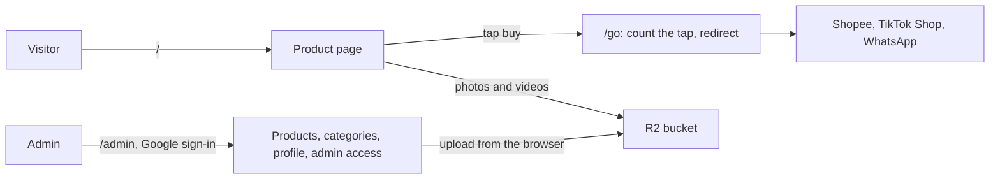
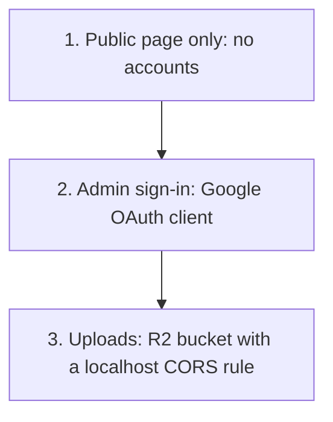

# pqacam

A personal product-finds page with buy links, and an admin to manage it. One owner, one page, one Docker container.

## Contents

- [What it does](#what-it-does)
- [Stack](#stack)
- [Run it locally](#run-it-locally)
  - [1. Public page only](#1-public-page-only)
  - [2. Admin sign-in](#2-admin-sign-in)
  - [3. Photo and video uploads](#3-photo-and-video-uploads)
- [Environment variables](#environment-variables)
- [Commands](#commands)
- [Project layout](#project-layout)
- [Troubleshooting](#troubleshooting)
- [Deploy](#deploy)
- [Documents](#documents)

---

## What it does



| Route | Who | Purpose |
|---|---|---|
| `/` | Everyone | Product grid with search, category tabs, shop filter, and a sheet for each product |
| `/go/<id>/<shop>` | Everyone | Adds 1 to the product's tap count, then redirects to the stored buy link |
| `/privacy` | Everyone | Privacy policy |
| `/admin` | Approved Google accounts | Manage products, categories, profile, and who has access |
| `/api/health` | Dokploy | Returns `{"ok":true}` when the database opens |

## Stack

| Part | Choice |
|---|---|
| Runtime and package manager | Bun 1.3 or later |
| Framework | TanStack Start (React 19, Vite, server rendering) |
| Database | SQLite file through Drizzle ORM and `bun:sqlite` |
| Admin sign-in | Google OAuth (Arctic), email allowlist in the database |
| Media | Cloudflare R2. The browser uploads with a presigned URL |
| Styling | One file, `src/styles.css` |
| Deploy | Dockerfile on Dokploy, database on a volume at `/data` |

## Run it locally

What works depends on which accounts are set up. Each level adds to the one before it.



| Level | Works | Needs |
|---|---|---|
| 1 | Public page, sample products, privacy page, tap counter | Bun |
| 2 | Level 1, plus sign-in and all admin edits that do not upload files | A Google OAuth client |
| 3 | Everything | An R2 bucket and token |

### 1. Public page only

1. Install Bun 1.3 or later: `curl -fsSL https://bun.sh/install | bash`. Check with `bun --version`.
2. Install the packages:

```bash
bun install
```

3. Make the local environment file. Bun reads `.env` automatically.

```bash
cp .env.example .env
mkdir -p data
```

4. In `.env`, set `SESSION_SECRET` to a random value of 32 characters or more:

```bash
openssl rand -base64 32
```

5. Add sample data:

```bash
bun run seed
```

6. Start the app:

```bash
bun run dev
```

7. Open `http://localhost:3000`. Expected: "The Cosy Corner" with 2 products.

The Google and R2 values in `.env` can stay empty at this level. The app reads each value only when a feature uses it.

### 2. Admin sign-in

1. Create a Google OAuth client of type "Web application". The steps are in [`docs/deploy.md`](docs/deploy.md), section 2.
2. In the client, under **Authorized redirect URIs** (not "Authorized JavaScript origins"), add:

```
http://localhost:3000/api/auth/google/callback
```

3. If the consent screen is in "Testing", add your Google account under "Audience", "Test users".
4. In `.env`, set:

| Variable | Value |
|---|---|
| `GOOGLE_CLIENT_ID` | From the client |
| `GOOGLE_CLIENT_SECRET` | From the client |
| `OWNER_EMAIL` | Your Google account |
| `PUBLIC_URL` | `http://localhost:3000` |

5. `OWNER_EMAIL` is added only when the admin list is empty. If the database already exists, start again with an empty one:

```bash
rm -rf data && mkdir data && bun run seed
```

6. Restart `bun run dev`. Open `http://localhost:3000/admin` and select "Continue with Google".

### 3. Photo and video uploads

1. Create an R2 bucket, a public custom domain for it, and an API token with "Object Read & Write" for that bucket. The steps are in [`docs/deploy.md`](docs/deploy.md), section 1.
2. In the bucket CORS policy, add `http://localhost:3000` to `AllowedOrigins`:

```json
[
  {
    "AllowedOrigins": ["https://pqacam.com", "http://localhost:3000"],
    "AllowedMethods": ["PUT"],
    "AllowedHeaders": ["content-type"],
    "MaxAgeSeconds": 3600
  }
]
```

3. In `.env`, set `R2_ACCOUNT_ID`, `R2_ACCESS_KEY_ID`, `R2_SECRET_ACCESS_KEY`, `R2_BUCKET`, and `MEDIA_BASE_URL`.
4. Restart `bun run dev`. In the admin, add a product with a photo.

Local uploads go to the same bucket as production unless you make a second bucket for development.

## Environment variables

| Variable | Needed from level | Value |
|---|---|---|
| `SESSION_SECRET` | 1 | Random, 32 characters or more. If it changes, admins sign in again |
| `DATABASE_PATH` | 1 | `./data/dev.db` locally. The Docker image sets `/data/pqacam.db` |
| `MEDIA_BASE_URL` | 1 | Public origin of the bucket, no slash at the end. Any value works at level 1 |
| `PUBLIC_URL` | 2 | Full origin, for example `http://localhost:3000` or `https://pqacam.com`. Not the domain alone |
| `OWNER_EMAIL` | 2 | First admin. Read only when the admin list is empty |
| `GOOGLE_CLIENT_ID`, `GOOGLE_CLIENT_SECRET` | 2 | Google OAuth client |
| `R2_ACCOUNT_ID`, `R2_ACCESS_KEY_ID`, `R2_SECRET_ACCESS_KEY`, `R2_BUCKET` | 3 | R2 token and bucket |

`PUBLIC_URL` must start with `https://` in production. The session cookie gets the `Secure` flag only then.

## Commands

| Command | Does |
|---|---|
| `bun run dev` | Development server on port 3000, with reload |
| `bun run seed` | Adds 2 sample products. Does nothing if the database has data |
| `bun test` | Unit tests |
| `bun run build` | Production build into `dist/`. Also writes `src/routeTree.gen.ts` |
| `bun run typecheck` | Type check. Run `bun run build` or `bun run dev` first after you add a route |
| `bun start` | Runs the production build (`bun server.ts`) |
| `bun run db:generate` | Makes a migration in `drizzle/` after a change to `src/server/schema.ts` |
| `docker build -t pqacam .` | Builds the production image |

Migrations run when the app opens the database, so a new migration applies on the next start.

## Project layout

| Path | Holds |
|---|---|
| `src/routes/` | Pages and server routes. `index.tsx` is `/`, `admin/` is the admin, `go.$productId.$platform.ts` is the tap counter |
| `src/components/public/`, `src/components/admin/` | Page parts |
| `src/server/` | All server logic. `catalog.ts` reads and writes data, `validate.ts` checks input, `fns.ts` is what the browser calls |
| `src/lib/` | Browser helpers: filter, upload, media protection |
| `src/styles.css` | All styles. Values come from the designs in `design/` |
| `tests/` | `bun test` files, one for each module in `src/server/` and `src/lib/` |
| `drizzle/` | SQL migrations |
| `scripts/seed.ts` | Sample data |
| `server.ts` | Production server: static files from `dist/client`, all else to the app |
| `design/` | The Claude Design prototype, for reference. Not part of the build |

## Troubleshooting

| Problem | Cause and fix |
|---|---|
| `Cannot find module 'bun:sqlite'` | Vite ran on Node. Use `bun run dev`, not `npx vite` |
| `Missing environment variable X` | `X` is not in `.env`. Add it and restart |
| Google shows `redirect_uri_mismatch` | The redirect URI in the Google client is not exactly `PUBLIC_URL` + `/api/auth/google/callback` |
| Google shows "Invalid Origin: URIs must not contain a path" | The callback URL is in "Authorized JavaScript origins". Move it to "Authorized redirect URIs" |
| Sign-in works but says "does not have admin access" | The account is not in the admin list. See step 5 of level 2 |
| Upload fails with a CORS error | `http://localhost:3000` is not in the bucket CORS policy |
| Type check fails on `routeTree.gen` | Run `bun run build` first |
| Port 3000 is in use | Stop the other process, or run `bun run dev -- --port 3001` and change `PUBLIC_URL` and the Google redirect URI to match |

## Deploy

[`docs/deploy.md`](docs/deploy.md) has the Cloudflare R2, Google, and Dokploy steps. In short: build type "Dockerfile", a volume mounted at `/data`, port `3000`, and the environment variables above with production values.

## Documents

| Document | Content |
|---|---|
| [`docs/PRD.md`](docs/PRD.md) | Requirements and decisions |
| [`docs/deploy.md`](docs/deploy.md) | Deployment steps |
| [`docs/superpowers/plans/2026-10-12-pqacam/`](docs/superpowers/plans/2026-10-12-pqacam/README.md) | The implementation plan |

Personal notes with real values go in a file that ends in `.local.md`. Git ignores those files.
