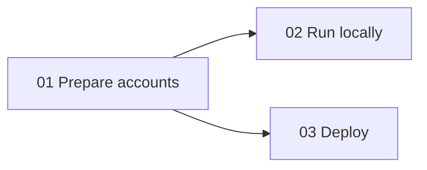
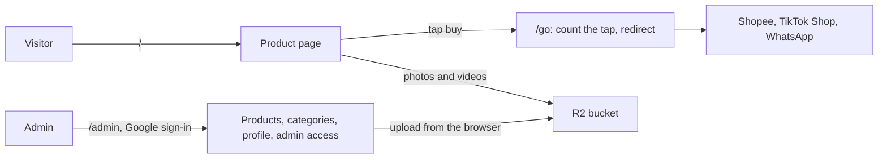

# pqacam

A personal product-finds page with buy links, and an admin to manage it. One owner, one page, one Docker container.

## Contents

- [Setup guides](#setup-guides)
- [Quick start](#quick-start)
- [What it does](#what-it-does)
- [Stack](#stack)
- [Commands](#commands)
- [Project layout](#project-layout)
- [Documents](#documents)

---

## Setup guides



| Guide | Read it to |
|---|---|
| [01 Prepare accounts](docs/setup/01-prepare.md) | Set up Google sign-in, Cloudflare R2, the Git repository, and the Dokploy server. Lists every value you end with |
| [02 Run locally](docs/setup/02-local.md) | Run the app on your computer, from "no accounts" to full uploads |
| [03 Deploy](docs/setup/03-deploy.md) | Put it on Dokploy, publish the Google app, set up backups, and check it |

## Quick start

No accounts are needed to see the public page with sample data.

```bash
bun install
cp .env.example .env
mkdir -p data
bun run seed
bun run dev
```

Open `http://localhost:3000`. For admin sign-in and uploads, see [02 Run locally](docs/setup/02-local.md).

## What it does



| Route | Who | Purpose |
|---|---|---|
| `/` | Everyone | Product grid with search, category tabs, shop filter, and a sheet for each product |
| `/go/<link id>` | Everyone | Adds 1 to the link's tap count, then redirects to the stored buy link |
| `/privacy` | Everyone | Privacy policy |
| `/admin` | Approved Google accounts | Manage products, categories, profile, and who has access |
| `/api/health` | Dokploy | Returns `{"ok":true}` when the database opens |

## Stack

| Part | Choice |
|---|---|
| Runtime and package manager | Bun 1.3 or later |
| Framework | TanStack Start (React 19, Vite, server rendering) |
| Database | SQLite file through Drizzle ORM and `bun:sqlite` |
| Admin sign-in | Google OAuth (Arctic), email allowlist in the database |
| Media | Cloudflare R2. The browser uploads with a presigned URL |
| Styling | One file, `src/styles.css` |
| Deploy | Dockerfile on Dokploy, database on a volume at `/data` |

## Commands

| Command | Does |
|---|---|
| `bun run dev` | Development server on port 3000, with reload |
| `bun run seed` | Adds 2 sample products. Does nothing if the database has data |
| `bun test` | Unit tests |
| `bun run build` | Production build into `dist/`. Also writes `src/routeTree.gen.ts` |
| `bun run typecheck` | Type check. Run `bun run build` first after you add a route |
| `bun start` | Runs the production build |
| `bun run db:generate` | Makes a migration after a change to `src/server/schema.ts` |

## Project layout

| Path | Holds |
|---|---|
| `src/routes/` | Pages and server routes. `index.tsx` is `/`, `admin/` is the admin, `go.$productId.$platform.ts` is the tap counter |
| `src/components/` | Page parts, in `public/` and `admin/` |
| `src/server/` | Server logic. `catalog.ts` reads and writes data, `validate.ts` checks input, `fns.ts` is what the browser calls |
| `src/lib/` | Browser helpers: filter, upload, media protection |
| `src/styles.css` | All styles. Values come from the designs in `design/` |
| `tests/` | `bun test` files |
| `drizzle/` | SQL migrations |
| `scripts/seed.ts` | Sample data |
| `server.ts` | Production server |
| `design/` | The Claude Design prototype, for reference. Not part of the build |

## Documents

| Document | Content |
|---|---|
| [`docs/PRD.md`](docs/PRD.md) | Requirements and decisions |
| [`docs/setup/`](docs/setup/01-prepare.md) | The three setup guides |
| [`docs/superpowers/plans/2026-10-12-pqacam/`](docs/superpowers/plans/2026-10-12-pqacam/README.md) | The implementation plan |

Personal notes with real values go in a file that ends in `.local.md`. Git ignores those files.
