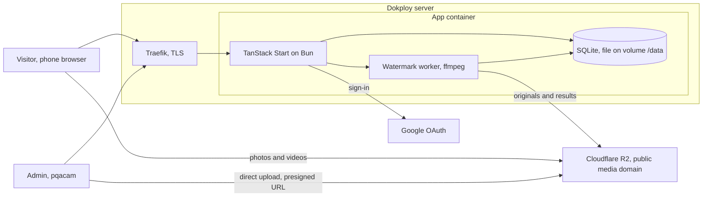
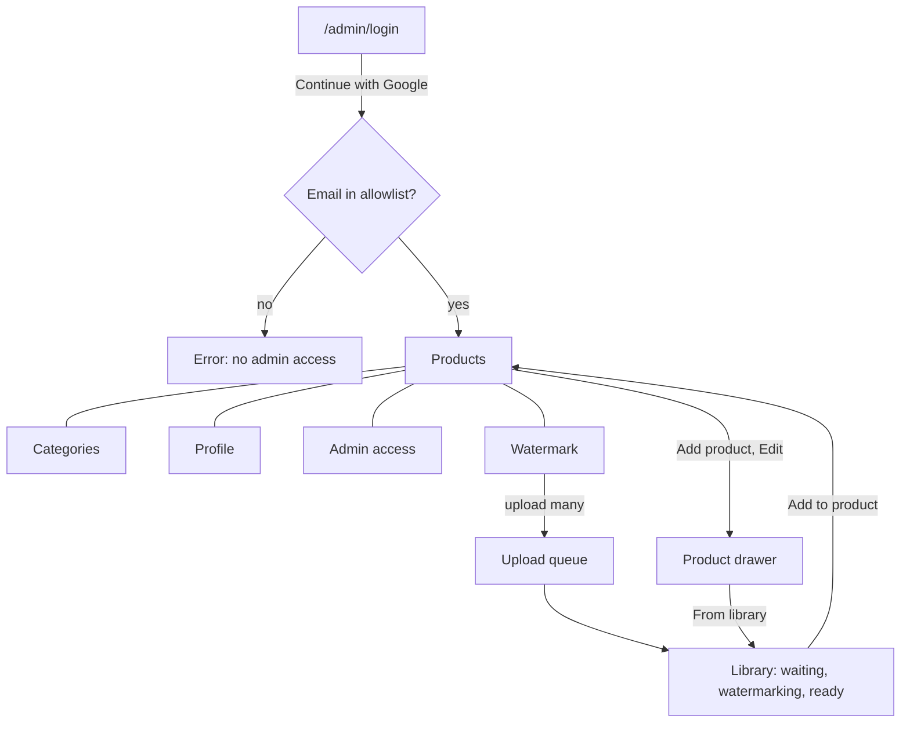
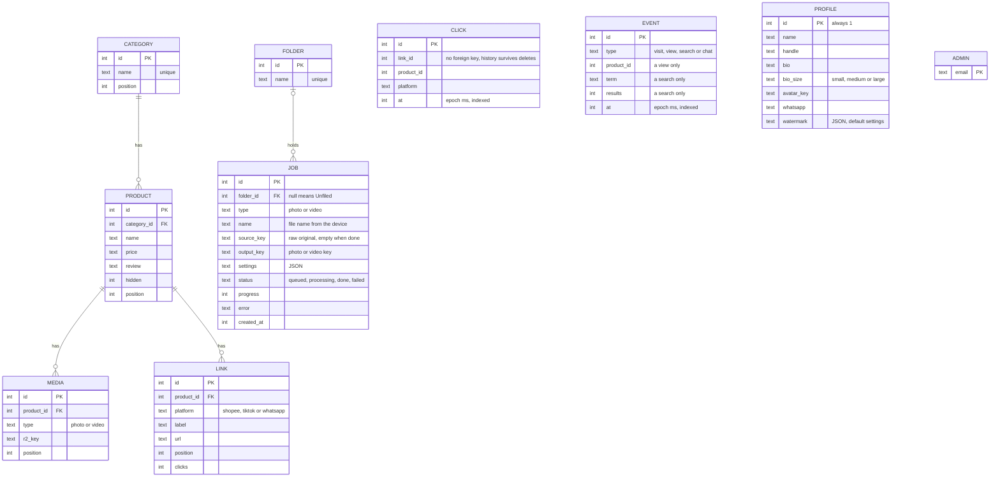
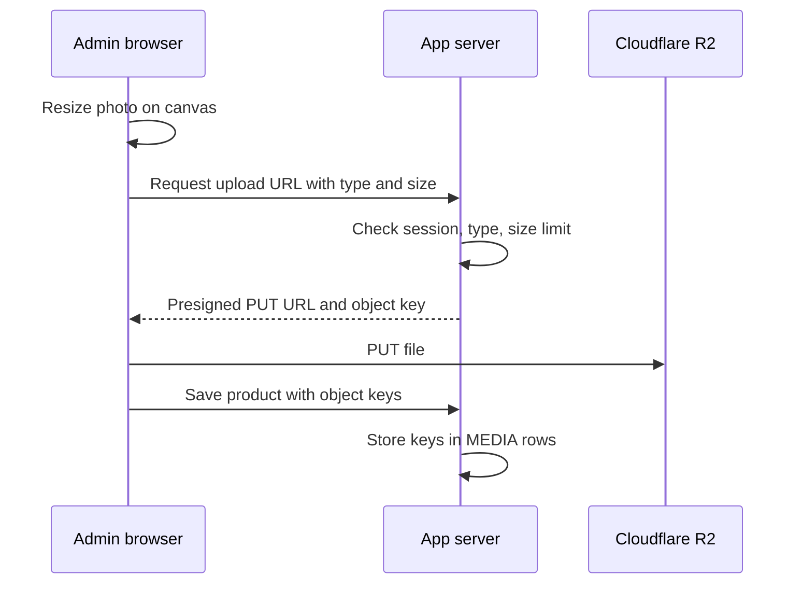

# pqacam: product requirements

## Contents

- [1. Summary](#1-summary)
- [2. Goals and success criteria](#2-goals-and-success-criteria)
- [3. Architecture](#3-architecture)
- [4. Decisions](#4-decisions)
- [5. Public page](#5-public-page)
- [6. Admin](#6-admin)
- [7. Data model](#7-data-model)
- [8. Routes](#8-routes)
- [9. Media](#9-media)
- [10. Deployment](#10-deployment)
- [11. Out of scope](#11-out-of-scope)
- [12. Open questions](#12-open-questions)

---

## 1. Summary

pqacam is a personal page in the style of beacons.ai, for one owner. Visitors browse product finds, read the owner's review, and tap a link to buy.

| Part | Who uses it | What it does |
|---|---|---|
| Public page | Visitors, mostly on phones | Shows products with search, category tabs, a platform filter, and buy buttons |
| Admin | pqacam and other approved Google accounts | Adds and edits products, categories, profile, and the list of approved accounts |

The visual reference is the Claude Design prototype in [`design/`](../design). The prototype stores data in `localStorage`. This product replaces that with a server, a database, and object storage.

## 2. Goals and success criteria

| Goal | Success criterion |
|---|---|
| The owner publishes a product without help | From sign-in to a live product with 3 photos in less than 2 minutes on a phone |
| Visitors find and open a buy link quickly | From page load to a tap on a buy button in 3 taps or fewer |
| The page loads fast on mobile data | Largest Contentful Paint less than 2.5 s on a simulated 4G connection with 50 products |
| The admin stays simple | 4 tabs. No theme, color, font, or layout settings |
| The owner sees which links get taps | Each product shows a click count for each platform |
| Shared links show a preview | A link pasted in WhatsApp shows the page name, bio, and avatar |
| Operation costs little | One container on the existing Dokploy server. R2 use stays in the free 10 GB tier |

## 3. Architecture



```embed height=560
diagrams/architecture.html
```

## 4. Decisions

| Decision | Chosen | Rejected | Why |
|---|---|---|---|
| Framework | TanStack Start (React, SSR) | Next.js, SvelteKit | Owner's choice. SSR gives share previews. Server functions cover the admin API |
| Runtime and package manager | Bun | Node with npm | Owner's choice. Bun includes a SQLite driver, so there is no native module to build |
| Database | SQLite file on a Dokploy volume, Drizzle ORM, `bun:sqlite` driver | Postgres service | One owner and hundreds of rows. No second service to operate |
| Admin sign-in | Google OAuth (Arctic library) with an email allowlist. Session in an encrypted cookie (TanStack Start `useSession`) | Single password, Better Auth | Matches the design. No passwords to store. No session tables |
| Media storage | Cloudflare R2, public bucket on a media subdomain | Dokploy volume, MinIO, AWS S3 | No egress fee. The container holds only the database |
| Upload path | The browser uploads to R2 with a presigned PUT URL | Upload through the app | Large files do not go through the container |
| Photo resize | In the browser on a canvas: 1000 px longest side, JPEG quality 0.82, as in the prototype | `sharp` on the server | No image library on the server |
| Video | Upload to R2. 50 MB limit. `mp4`, `webm`, `mov` | The "Paste a video link" field in the prototype | Owner's choice. The owner does not need a second host for videos |
| Click counts | `/go/$productId/$platform` adds 1 to a counter, then redirects | Third-party analytics | One route. No tracking script on the page |
| Order of items | Up and down buttons, as in the prototype | Drag and drop | Works on phones without a library |
| Customization | None. Colors, fonts, and layout are fixed from the design | Theme settings | The owner asked for a simple admin |

## 5. Public page

Source: [`design/Home Finds Links.dc.html`](../design/Home%20Finds%20Links.dc.html).

| Area | Requirement |
|---|---|
| Header | Avatar, page name, handle, bio |
| Search | Field that stays at the top during scroll. Filters by product name, category, and review text in the browser |
| Category tabs | "All", then the categories in admin order |
| Platform filter | Any, Shopee, TikTok, WhatsApp |
| Grid | 2 columns. Each card shows the cover photo, media count, name, price if set, and a chip for each platform that has a link |
| Product sheet | Opens from the bottom. Shows, in order: the media carousel (square, at most 40% of the screen height), category, name, price if set, the buy buttons, then "My honest review". The buttons come before the review so they show without scrolling, down to an iPhone SE screen |
| Carousel | Swipe, arrows, dots, and a counter. Advances automatically: 3.5 s for a photo, 7 s for a video. Stops advancing after the visitor moves it. Videos play muted in a loop |
| Buy buttons | One per shop. A shop with one link opens it directly; with a label it shows "Shopee · <label>". A shop with several links shows "Buy on Shopee · N options", which opens a list of the links by label. Each link opens `/go/$linkId` in a new tab |
| WhatsApp button | Round button at the bottom left, shown when the profile has a WhatsApp number. Opens a chat with that number |
| Empty result | "Nothing here yet" with a link that clears search and filters |
| Hidden products | The server does not send them to the browser |
| Share preview | SSR `title`, `description` from the bio, and Open Graph image from the avatar |
| Footer | Privacy link |

### Media protection

| Measure | Behavior |
|---|---|
| Context menu and drag | Blocked on media |
| Focus loss | Sheet media changes to "Content protected" while the window is not in focus |
| Print | The page prints blank |

These measures stop casual saves. They do not stop a phone screenshot, and the media URLs on R2 are public.

## 6. Admin

Source: [`design/Admin.dc.html`](../design/Admin.dc.html).



| Screen | Requirement |
|---|---|
| Sign-in | One "Continue with Google" button. An email that is not in the allowlist gets the error text from the design |
| Session | The server checks the allowlist on each admin request. A removed email loses access on its next request |
| Products | List with search, thumbnail, category, media count, platform chips, "No buy link" chip, Live/Hidden toggle, Edit. Drag the handle to reorder, or focus it and use the arrow keys. Reordering is off while a search is active |
| Click counts | Each product row shows the count for each platform, summed over its links. This is an addition to the design |
| Analytics | Filters: range (7, 30 or 90 days, Malaysia time), category, product, shop. The filters apply to product views and buy taps; visits, searches and chats count the whole page. Tiles: visits, product views, buy taps, taps per visit, WhatsApp chats, each against the previous period. Sections: Overview (busiest hour and weekday as small charts, taps by shop as one stacked bar, visit-to-tap funnel, top product, searches, live products with no taps, taps by day), Visits (by day, hour, weekday), Taps (by day, hour, weekday), Products (views and taps per product), Shops (by shop, top buy links), Searches (most searched, searches that found nothing) |
| Product drawer | Photos and videos, name, category, price (optional text), review with character count and an Expand button that opens a full-screen editor, Shopee / TikTok / WhatsApp links (several per platform, each with an optional label), "Show on my page" toggle |
| Drawer media | Add photos (several at one time), add a video, add from the watermark library, remove, drag to reorder, move earlier. The first photo is the cover |
| "Use my number" | Fills that WhatsApp link from the profile number, with an order message that includes the product name |
| Delete product | Two taps: "Delete", then "Tap again to delete". Also deletes the product's media from R2 |
| Validation | Name is required. At least one buy link is required. Each link must start with `https://`. The server applies the same rules |
| Categories | Add, rename, move up and down, delete. Delete is blocked while the category has products. Names are unique |
| Profile | Avatar upload (400 px), page name, handle, bio (Enter starts a new paragraph) with a text size of Small, Medium or Large, WhatsApp number. Changes save automatically |
| Watermark | Settings with a live preview: text (default: the handle), font, position (moving bounce or a fixed corner), size, opacity, speed. "+ Add photos & videos" takes many files. The server watermarks them one at a time. Each batch keeps the settings it was added with, and they become the next defaults |
| Watermark uploads | One upload at a time, with a progress bar. The queue continues while the admin uses other tabs. The page asks before it closes, and keeps the screen awake. The upload stops if the page closes, because a browser cannot upload from a closed page |
| Watermark library | Each file shows "Waiting", "Watermarking" with a percentage, "Ready" or "Failed". Failed: "Try again", Delete. The list updates every 3 s while work is running |
| Previewer | Tap a ready file to open it full size: photo, or video with controls. Previous and next by button, arrow key, or swipe, within the open folder. Actions: "Add to product…", move to a folder, "Copy link", Delete. Full screen below 760 px |
| Folders | Chips filter the library: All, Unfiled, then each folder by name, with counts. "+ New folder", Rename, "Delete folder" (two taps). Uploads go to the open folder. Deleting a folder moves its files to Unfiled and deletes no file. Names are unique, ignoring case. The product editor's library picker has a folder filter |
| Admin access | List of emails. Add and remove. An admin cannot remove their own email |
| Layout | Sidebar at 760 px and wider. Below 760 px: header with tab pills that stays at the top |
| Feedback | A toast confirms each save, as in the design |

## 7. Data model



| Prototype field | In the product | Reason |
|---|---|---|
| `tag` | Dropped | The prototype sets it to empty for all products and does not show it |
| `tint` | Dropped | It colors the placeholder only. Real products have photos |
| `price` | Kept as text | The owner types "RM 24.90". No arithmetic is done on it |

## 8. Routes

| Route | Access | Purpose |
|---|---|---|
| `/` | Public | The page, SSR |
| `/go/$linkId` | Public | Add 1 to the link's click count, then redirect (302) to its URL |
| `/admin` | Allowlist | Admin with 6 tabs |
| `/api/event` | Public | Record a visit, product view, search or WhatsApp chat (POST, always 204) |
| `/admin/login` | Public | Sign-in screen |
| `/api/auth/google` | Public | Start the Google OAuth flow |
| `/api/auth/google/callback` | Public | Finish the flow, check the allowlist, set the session cookie |
| `/api/health` | Public | Health check for Dokploy |

Admin reads and writes are TanStack Start server functions. Each function checks the session and the allowlist before it does work.

`/go` redirects only to a stored link of a product that is not hidden. It does not accept a destination from the request, so it cannot be used as an open redirect.

## 9. Media



| Rule | Value |
|---|---|
| Photo | JPEG, 1000 px longest side, quality 0.82. Avatar: 400 px |
| Video | `mp4`, `webm`, or `mov`. 50 MB maximum. The editor checks size and type before upload and names the file in the error, under the media tiles |
| Size and type check | The presigned URL signs `Content-Type` and `Content-Length`, so R2 rejects a different file |
| Object key | Random ID from the server. The file name from the device is not used |
| Public URL | `MEDIA_BASE_URL` + object key, served through the Cloudflare CDN |
| Delete | When an admin removes media or deletes a product, the server deletes the objects from R2. An object stays while a product or a library item still uses it |
| Watermark original | `raw/` key, any of JPEG, `mp4`, `webm`, `mov`. 1 GB maximum. Deleted when its result exists. An R2 lifecycle rule deletes any left over after 2 days |
| Watermark result | Video: H.264 `mp4`, long side 1920 px at most, AAC audio, HDR tone mapped to SDR, metadata (GPS) removed. Photo: JPEG, 1000 px. Fonts in `public/fonts` |

## 10. Deployment

| Item | Value |
|---|---|
| Build | Multi-stage `Dockerfile` on the `oven/bun:1` image, with Debian's `ffmpeg`. `bun install --frozen-lockfile`, then `bun run build`. Dokploy builds it from the Git repository |
| Start | The container runs the built server with `bun` and listens on port 3000 |
| Volume | `/data` holds `pqacam.db` in WAL mode |
| Migrations | Drizzle migrations run when the container starts |
| Domain and TLS | Traefik in Dokploy, with a Let's Encrypt certificate |
| Health check | `GET /api/health` returns 200 when the database opens |
| Backup | Dokploy volume backup of `/data` to an R2 bucket, one time each day |
| First admin | When the `ADMIN` table is empty, the server adds `OWNER_EMAIL` |

| Environment variable | Purpose |
|---|---|
| `PUBLIC_URL` | Site origin, used for OAuth callback and Open Graph URLs |
| `SESSION_SECRET` | Key for the session cookie, 32 characters or more |
| `OWNER_EMAIL` | First approved Google account |
| `GOOGLE_CLIENT_ID`, `GOOGLE_CLIENT_SECRET` | Google OAuth client |
| `R2_ACCOUNT_ID`, `R2_ACCESS_KEY_ID`, `R2_SECRET_ACCESS_KEY`, `R2_BUCKET` | R2 access for presigned URLs and deletes |
| `MEDIA_BASE_URL` | Public origin of the bucket |
| `DATABASE_PATH` | Path of the SQLite file. Default `/data/pqacam.db` |

Setup outside the repository: a Google Cloud OAuth client with the callback URL, an R2 bucket with a custom domain and a CORS rule that permits `PUT` from `PUBLIC_URL`, and DNS records for the site and the media subdomain.

## 11. Out of scope

| Not in version 1 | Add when |
|---|---|
| More than one page or owner | A second person needs their own page |
| Themes, colors, fonts, custom blocks | The owner asks for a different look |
| Cart, payments, orders | Sales move away from Shopee, TikTok, and WhatsApp |
| Click charts by date | A total for each product is not sufficient |
| Video compression on the server | 50 MB videos load too slowly for visitors |
| A URL for each product with its own share preview | The owner frequently shares one product at a time |
| Platforms other than Shopee, TikTok, WhatsApp | The owner sells on a fourth platform |

## 12. Open questions

| Question | Default if there is no answer |
|---|---|
| Full domain name | `pqacam.com`, with media on `media.pqacam.com` |
| Interface language | English, as in the design |
| Do visits from bots count as clicks | Yes. Version 1 has no bot filter |
| Video size limit | 50 MB |
