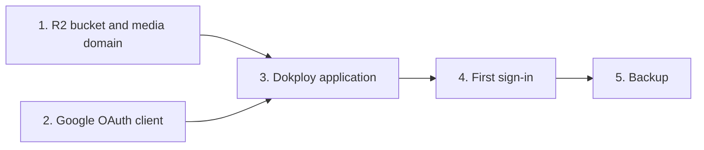

# Deploy pqacam on Dokploy

## Contents

- [1. Cloudflare R2](#1-cloudflare-r2)
- [2. Google sign-in](#2-google-sign-in)
- [3. Dokploy application](#3-dokploy-application)
- [4. First sign-in](#4-first-sign-in)
- [5. Backup and restore](#5-backup-and-restore)

---



## 1. Cloudflare R2

1. Create a bucket, for example `pqacam-media`.
2. In the bucket settings, connect a custom domain, for example `media.pqacam.com`. This makes the objects public through the Cloudflare CDN.
3. Add this CORS policy to the bucket. It lets the admin page upload files from the browser.

```json
[
  {
    "AllowedOrigins": ["https://pqacam.com"],
    "AllowedMethods": ["PUT"],
    "AllowedHeaders": ["content-type"],
    "MaxAgeSeconds": 3600
  }
]
```

4. Create an R2 API token with "Object Read & Write" permission for this bucket only. Keep the access key ID and the secret access key.

## 2. Google sign-in

1. In Google Cloud Console, create an OAuth client of type "Web application".
2. Add the authorized redirect URI `https://pqacam.com/api/auth/google/callback`.
3. Keep the client ID and the client secret.

## 3. Dokploy application

1. Create an application from the Git repository. Set the build type to "Dockerfile".
2. Add a volume mount: type "Volume", name `pqacam-data`, mount path `/data`.
3. Add the domain `pqacam.com` with port `3000`, HTTPS on, certificate "Let's Encrypt".
4. Set the environment variables.

| Variable | Value |
|---|---|
| `PUBLIC_URL` | `https://pqacam.com` |
| `SESSION_SECRET` | Output of `openssl rand -base64 32` |
| `OWNER_EMAIL` | The Google account of the owner |
| `GOOGLE_CLIENT_ID`, `GOOGLE_CLIENT_SECRET` | From step 2 |
| `R2_ACCOUNT_ID` | The Cloudflare account ID |
| `R2_ACCESS_KEY_ID`, `R2_SECRET_ACCESS_KEY` | From step 1 |
| `R2_BUCKET` | `pqacam-media` |
| `MEDIA_BASE_URL` | `https://media.pqacam.com` |

5. Deploy. `https://pqacam.com/api/health` returns `{"ok":true}`.

## 4. First sign-in

1. Open `https://pqacam.com/admin` and sign in with `OWNER_EMAIL`.
2. In Profile, set the page name, handle, bio, photo, and WhatsApp number.
3. In Categories, add one category or more.
4. In Products, add the first product.

`OWNER_EMAIL` is read only when the admin list is empty. After the first start, change the list in the Admin access tab.

## 5. Backup and restore

| Data | Where | Backup |
|---|---|---|
| Products, categories, profile, admin list, click counts | `/data/pqacam.db` in the `pqacam-data` volume | Dokploy volume backup, each day, to an S3 destination (a second R2 bucket works) |
| Photos and videos | R2 bucket | Not in the volume backup. R2 keeps them when the server is replaced |

To restore: stop the application, restore the volume from the backup in Dokploy, start the application.
