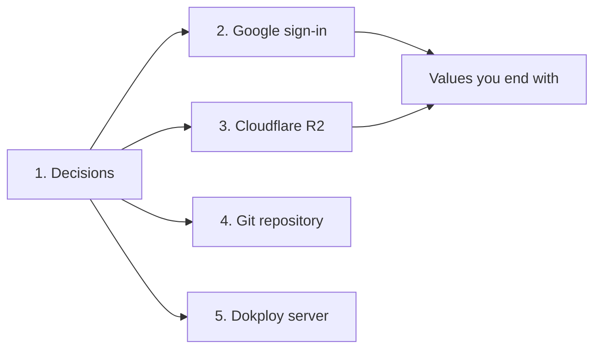

# 01. Prepare accounts

Part of the setup guides: **01 Prepare** · [02 Run locally](02-local.md) · [03 Deploy](03-deploy.md).

## Contents

- [What to prepare](#what-to-prepare)
- [1. Decisions](#1-decisions)
- [2. Google sign-in](#2-google-sign-in)
  - [2.1 Project and consent screen](#21-project-and-consent-screen)
  - [2.2 Test users](#22-test-users)
  - [2.3 OAuth client](#23-oauth-client)
- [3. Cloudflare R2](#3-cloudflare-r2)
  - [3.1 Domain on Cloudflare](#31-domain-on-cloudflare)
  - [3.2 Bucket and media domain](#32-bucket-and-media-domain)
  - [3.3 CORS policy](#33-cors-policy)
  - [3.4 API token](#34-api-token)
  - [3.5 Backup bucket](#35-backup-bucket)
  - [3.6 Lifecycle rule for originals](#36-lifecycle-rule-for-originals)
- [4. Git repository](#4-git-repository)
- [5. Dokploy server](#5-dokploy-server)
- [Values you end with](#values-you-end-with)
- [Troubleshooting](#troubleshooting)

---

## What to prepare



| Item | Local, level 1 | Local, levels 2 and 3 | Production | Cost |
|---|---|---|---|---|
| Decisions | No | Owner email | All | None |
| Google OAuth client | No | Yes (level 2) | Yes | Free |
| Cloudflare zone for the domain | No | Yes (level 3) | Yes | Free plan |
| R2 bucket, media domain, token | No | Yes (level 3) | Yes | 10 GB free each month. A payment card is required to enable R2 |
| Backup bucket | No | No | Recommended | Same as above |
| Git repository with a remote | No | No | Yes | Free on most hosts |
| Server with Dokploy | No | No | Yes | Server cost |

Levels are defined in [02 Run locally](02-local.md).

## 1. Decisions

| Decision | Default in these guides |
|---|---|
| Site domain | `pqacam.com`. Replace it in each command and value below if different |
| Media domain | `media.pqacam.com` |
| Owner Google account | The first admin. Later admins are added in the admin |
| Bucket names | `pqacam-media` for media, `pqacam-backup` for backups |
| Main address | `https://pqacam.com`. `www` and `http` redirect to it ([03 Deploy](03-deploy.md), step 5). If you choose `www.pqacam.com` as the main address, use it in every place that asks for the site domain |

## 2. Google sign-in

Console: <https://console.cloud.google.com>, menu "Google Auth Platform".

| Choice | Use | Reason |
|---|---|---|
| Audience | **External** | "Internal" is only for a Google Workspace organization. Gmail accounts need "External" |
| Publishing status | **Testing** now. **In production** after deploy | "Publish app" needs the Branding page, which needs the live site. [03 Deploy](03-deploy.md), step 8 |
| Scopes | Do not add any | The app asks for `openid`, `email`, `profile` at sign-in. These are not sensitive, so no Google verification |
| Application type | **Web application** | The server exchanges the code with the client secret |
| App logo | Leave empty | A logo starts brand verification, which this app does not need |

### 2.1 Project and consent screen

1. Open the project list at the top. Select "New project". Name: `pqacam`. Organization: "No organization". Select "Create". Make sure it is the selected project.
2. Open "Google Auth Platform". Select "Get started".
3. App Information: App name `pqacam admin`, User support email: yours. Select "Next".
4. Audience: **External**. Select "Next".
5. Contact Information: your email. Select "Next".
6. Agree to the "Google API Services: User Data Policy". Select "Continue", then "Create".

### 2.2 Test users

1. Open "Audience". Publishing status is "Testing".
2. Under "Test users", select "Add users". Add each admin Google account (100 maximum). Select "Save".

While the status is "Testing", an account must be in this list **and** in the pqacam Admin access list.

### 2.3 OAuth client

1. Open "Clients". Select "Create client".
2. Application type: **Web application**. Name: `pqacam web`.
3. **Authorized JavaScript origins**: leave empty.
4. **Authorized redirect URIs**: select "Add URI" for each line:

```
https://pqacam.com/api/auth/google/callback
http://localhost:3000/api/auth/google/callback
```

5. Select "Create".
6. Copy the Client ID and the Client secret now. Google shows the full secret only at creation.

## 3. Cloudflare R2

Dashboard: <https://dash.cloudflare.com>.

| Choice | Use | Reason |
|---|---|---|
| Public access | **Custom domain** | The `r2.dev` URL is rate-limited and for tests only. Leave it disabled |
| Location, storage class | "Automatic", "Standard" | No region requirement. Media is read often |
| Token type | **Account API token** | A "User API token" stops working when that user leaves the account |
| Token permission | **Object Read & Write**, one bucket | The app only puts and deletes objects |

### 3.1 Domain on Cloudflare

A bucket custom domain works only for a domain whose DNS is in the same Cloudflare account. Skip this if it already is.

1. Account home, "Add a domain". Enter `pqacam.com`. Select the Free plan.
2. Set the 2 nameservers that Cloudflare shows at your domain registrar.
3. Wait for the zone status "Active".

### 3.2 Bucket and media domain

1. Open "R2 Object Storage". The first time, enable R2 with a payment card.
2. "Create bucket". Name `pqacam-media`, location "Automatic", storage class "Standard". Select "Create bucket".
3. In the bucket, "Settings". Under "Custom Domains", select "Add".
4. Enter `media.pqacam.com`. Select "Continue", then "Connect Domain".
5. Wait for the status to change from "Initializing" to "Active".

### 3.3 CORS policy

1. Bucket "Settings". Under "CORS Policy", select "Add CORS policy".
2. In the "JSON" tab, enter this policy. Select "Save".

```json
[
  {
    "AllowedOrigins": ["https://pqacam.com", "http://localhost:3000"],
    "AllowedMethods": ["PUT"],
    "AllowedHeaders": ["content-type"],
    "MaxAgeSeconds": 3600
  }
]
```

An origin has no path and no slash at the end. Remove the `localhost` line if you do not upload from your computer.

### 3.4 API token

1. "R2 Object Storage". Under "Account Details", select "Manage" next to "API Tokens".
2. Select "Create Account API token". Name `pqacam app`. Permissions: **Object Read & Write**.
3. Select "Apply to specific buckets only", then `pqacam-media`. TTL: "Forever". Create the token.
4. Copy "Access Key ID" and "Secret Access Key" now. The secret is shown one time only. "Token value" is not used.
5. The Account ID is in the endpoint on the same page: `https://<ACCOUNT_ID>.r2.cloudflarestorage.com`.

### 3.5 Backup bucket

For production only.

1. Create a second bucket, `pqacam-backup`. Do not connect a domain.
2. Create a second Account API token: **Object Read & Write**, for `pqacam-backup` only. Copy its two keys. [03 Deploy](03-deploy.md), step 9 uses them.

### 3.6 Lifecycle rule for originals

The Watermark tab uploads each original to `raw/` in the media bucket. The server deletes it when the watermarked file is ready. An upload that stops halfway leaves its original behind. This rule deletes those.

1. Bucket `pqacam-media`, "Settings". Under "Object Lifecycle Rules", select "Add rule".
2. Name `raw uploads`. Select "Apply to objects with prefix", and enter `raw/`.
3. Select "Delete uploaded objects after", and enter **2** days. Select "Save".

## 4. Git repository

Dokploy builds from Git. The repository has no remote now.

1. Create a **private** repository on GitHub, GitLab, Gitea, or Bitbucket.
2. Push:

```bash
git remote add origin <repository URL>
git push -u origin main
```

## 5. Dokploy server

| Need | Detail |
|---|---|
| A server with Dokploy installed | Dokploy's own minimum is 2 GB of RAM. The app's memory use was not measured |
| The server's public IPv4 address | For the DNS record in [03 Deploy](03-deploy.md), step 1 |
| Ports 80 and 443 open | For Traefik and Let's Encrypt |
| Dokploy connected to the Git host | In Dokploy, "Settings", "Git": add the GitHub app or a deploy key |

## Values you end with

| Variable | Comes from | Local value | Production value |
|---|---|---|---|
| `GOOGLE_CLIENT_ID` | 2.3 | same | same |
| `GOOGLE_CLIENT_SECRET` | 2.3 | same | same |
| `R2_ACCOUNT_ID` | 3.4 | same | same |
| `R2_ACCESS_KEY_ID` | 3.4 | same | same |
| `R2_SECRET_ACCESS_KEY` | 3.4 | same | same |
| `R2_BUCKET` | 3.2 | `pqacam-media` | `pqacam-media` |
| `MEDIA_BASE_URL` | 3.2 | `https://media.pqacam.com` | `https://media.pqacam.com` |
| `OWNER_EMAIL` | 1 | your Google account | your Google account |
| `PUBLIC_URL` | 1 | `http://localhost:3000` | `https://pqacam.com` |
| `SESSION_SECRET` | `openssl rand -base64 32` | one value | a different value |
| `DATABASE_PATH` | none | `./data/dev.db` | do not set |

`PUBLIC_URL` is the full origin: scheme and host, no path, no slash at the end. It must be the same host as the Google redirect URI and the R2 CORS origin.

Keep the secrets in a password manager, or in a file that ends in `.local.md` (Git ignores those files).

## Troubleshooting

| Problem | Cause |
|---|---|
| Google: "Invalid Origin: URIs must not contain a path or end with /" | The callback URL is in "Authorized JavaScript origins". Move it to "Authorized redirect URIs" |
| Google: `Error 400: redirect_uri_mismatch` | The redirect URI is not exactly `PUBLIC_URL` + `/api/auth/google/callback`. Check `http`/`https`, `www`, and a slash at the end |
| Google: "Access blocked" | Status is "Testing" and the account is not a test user |
| Google client secret lost | In the client, add a new secret, use it, then delete the old one |
| R2 custom domain stays "Initializing" | The zone is not "Active", or the domain is in a different Cloudflare account |
| R2 secret access key lost | Delete the token and make a new one |

Labels in the Google consent screen, the Audience page, and the Dokploy menus are from memory, checked against the official documentation on 2026-10-12 where it describes them. The screens can differ slightly.
