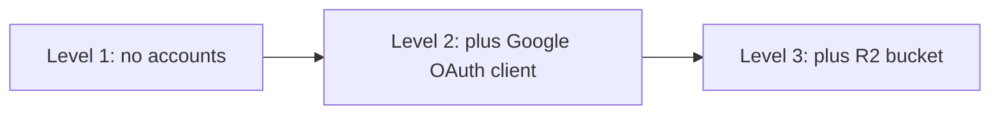

# 02. Run locally

Part of the setup guides: [01 Prepare](01-prepare.md) · **02 Run locally** · [03 Deploy](03-deploy.md).

## Contents

- [Levels](#levels)
- [Level 1: public page only](#level-1-public-page-only)
- [Level 2: admin sign-in](#level-2-admin-sign-in)
- [Level 3: photo and video uploads](#level-3-photo-and-video-uploads)
- [Everyday tasks](#everyday-tasks)
- [Troubleshooting](#troubleshooting)

---

## Levels



| Level | Works | Needs from [01 Prepare](01-prepare.md) |
|---|---|---|
| 1 | Public page, sample products, privacy page, tap counter | Nothing |
| 2 | Level 1, plus admin sign-in and all edits that do not upload files | Section 2 |
| 3 | Everything | Sections 3.1 to 3.4 |

The app reads each environment variable only when a feature uses it. So a value that a level does not need can stay empty.

## Level 1: public page only

1. Install Bun 1.3 or later, then check it:

```bash
curl -fsSL https://bun.sh/install | bash
bun --version
```

2. In the project folder, install the packages and make the local files:

```bash
bun install
cp .env.example .env
mkdir -p data
```

3. In `.env`, set `SESSION_SECRET` to the output of `openssl rand -base64 32`.
4. Add sample data and start the app:

```bash
bun run seed
bun run dev
```

5. Open `http://localhost:3000`. Expected: "The Cosy Corner" with 2 products.

## Level 2: admin sign-in

1. Make sure the Google OAuth client has the redirect URI `http://localhost:3000/api/auth/google/callback`, and your account is a test user. [01 Prepare](01-prepare.md), sections 2.2 and 2.3.
2. In `.env`, set:

| Variable | Value |
|---|---|
| `GOOGLE_CLIENT_ID`, `GOOGLE_CLIENT_SECRET` | From the client |
| `OWNER_EMAIL` | Your Google account |
| `PUBLIC_URL` | `http://localhost:3000` |

3. The app adds `OWNER_EMAIL` only to an empty admin list. If `data/dev.db` was made before you set it, start with a new database:

```bash
rm -rf data && mkdir data && bun run seed
```

4. Restart `bun run dev`. Open `http://localhost:3000/admin`. Select "Continue with Google".

## Level 3: photo and video uploads

1. Make sure the bucket CORS policy has `http://localhost:3000` in `AllowedOrigins`. [01 Prepare](01-prepare.md), section 3.3.
2. In `.env`, set `R2_ACCOUNT_ID`, `R2_ACCESS_KEY_ID`, `R2_SECRET_ACCESS_KEY`, `R2_BUCKET`, and `MEDIA_BASE_URL`.
3. Restart `bun run dev`. In the admin, add a product with a photo.

Local uploads go to the production bucket. To keep them apart, make a second bucket such as `pqacam-media-dev`, give it a domain and the same CORS policy, and use it in `.env`.

## Everyday tasks

| Task | Command |
|---|---|
| Start with reload | `bun run dev` |
| Run the tests | `bun test` |
| Check types | `bun run build && bun run typecheck` |
| Start again with an empty database | `rm -rf data && mkdir data && bun run seed` |
| Change the database schema | Edit `src/server/schema.ts`, then `bun run db:generate`. The migration applies on the next start |
| Run the production build | `bun run build && bun start` |
| Run the Docker image | `docker build -t pqacam . && docker run --rm -p 3000:3000 --env-file .env -e DATABASE_PATH=/data/pqacam.db -v pqacam-data:/data pqacam` |

## Troubleshooting

| Problem | Cause and fix |
|---|---|
| `Cannot find module 'bun:sqlite'` | Vite ran on Node. Use `bun run dev`, not `npx vite` |
| `Missing environment variable X` | A feature needs `X`. Add it to `.env` and restart |
| "does not have admin access" after Google sign-in | The account is not in the admin list. See level 2, step 3 |
| Upload fails with a CORS error in the browser console | `http://localhost:3000` is not in the bucket CORS policy |
| Upload fails with `403 SignatureDoesNotMatch` | Wrong R2 secret key, account ID, or bucket name |
| Photos upload but do not show | `MEDIA_BASE_URL` is wrong, or the media domain is not "Active" |
| Type check fails on `routeTree.gen` | Run `bun run build` first. It writes that file |
| Port 3000 is in use | `bun run dev -- --port 3001`, and use port 3001 in `PUBLIC_URL`, the Google redirect URI, and the CORS policy |
