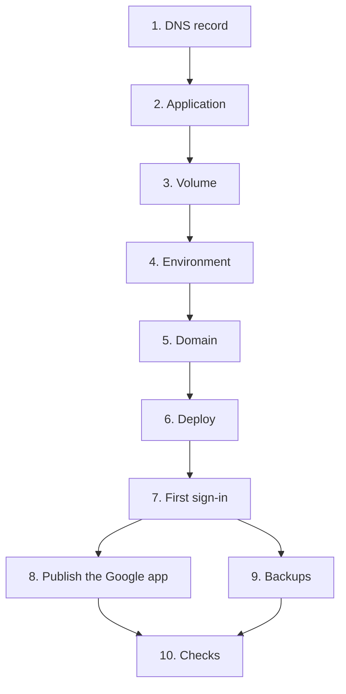

# 03. Deploy on Dokploy

Part of the setup guides: [01 Prepare](01-prepare.md) · [02 Run locally](02-local.md) · **03 Deploy**.

## Contents

- [Before you start](#before-you-start)
- [Steps](#steps)
- [1. DNS record](#1-dns-record)
- [2. Application](#2-application)
- [3. Volume](#3-volume)
- [4. Environment](#4-environment)
- [5. Domain](#5-domain)
- [6. Deploy](#6-deploy)
- [7. First sign-in](#7-first-sign-in)
- [8. Publish the Google app](#8-publish-the-google-app)
- [9. Backups](#9-backups)
- [10. Checks after the first deploy](#10-checks-after-the-first-deploy)
- [Updates and restore](#updates-and-restore)
- [Troubleshooting](#troubleshooting)

---

## Before you start

Everything in [01 Prepare](01-prepare.md) is done: Google OAuth client, R2 bucket with an "Active" media domain, CORS policy, API tokens, the repository pushed, and Dokploy connected to the Git host.

## Steps



| Setting | Use | Reason |
|---|---|---|
| Service type | **Application** | One container |
| Build type | **Dockerfile** | `Dockerfile` is at the repository root |
| Mount type | **Volume Mount** at `/data` | Docker manages it and Dokploy can back it up |
| Container port | `3000` | The port in the `Dockerfile` |
| Certificate | **Let's Encrypt** | Free, renewed by Traefik |

## 1. DNS record

1. Cloudflare, zone `pqacam.com`, "DNS", "Records", "Add record".
2. Type `A`, name `@`, IPv4 address: the Dokploy server.
3. Proxy status: **DNS only** (grey cloud). Let's Encrypt must reach the server directly the first time.

After the certificate works, you can turn the proxy on. Then set "SSL/TLS" mode to **Full (strict)**. "Flexible" causes a redirect loop.

## 2. Application

1. Dokploy, "Projects", "Create Project". Name `pqacam`.
2. In the project, "Create Service", "Application". Name `pqacam`.
3. Tab "General", "Provider": select the Git host, the repository, branch `main`, build path `/`. Select "Save".
4. "Build Type": **Dockerfile**. Dockerfile Path `Dockerfile`. Docker Context Path `.`. Docker Build Stage: empty. Select "Save".

## 3. Volume

1. Tab "Advanced", "Volumes", "Add Volume".
2. Mount Type **Volume Mount**. Volume Name `pqacam-data`. Mount Path `/data`. Select "Create".

Do this before the first deploy. Without it, each deploy erases all products, categories, and admins.

## 4. Environment

Tab "Environment". Paste these lines with your values from [01 Prepare](01-prepare.md), "Values you end with". Select "Save".

```
PUBLIC_URL=https://pqacam.com
SESSION_SECRET=
OWNER_EMAIL=
GOOGLE_CLIENT_ID=
GOOGLE_CLIENT_SECRET=
R2_ACCOUNT_ID=
R2_ACCESS_KEY_ID=
R2_SECRET_ACCESS_KEY=
R2_BUCKET=pqacam-media
MEDIA_BASE_URL=https://media.pqacam.com
```

- `SESSION_SECRET`: a new value from `openssl rand -base64 32`, not the local one.
- Do not set `DATABASE_PATH`. The image uses `/data/pqacam.db`.
- Leave "Build Time Arguments" and "Build-time Secrets" empty. The build needs no secrets.

## 5. Domain

1. Tab "Domains", "Add Domain".
2. Host `pqacam.com`. Path `/`. Container Port `3000`. HTTPS on. Certificate **Let's Encrypt**. Select "Create".

## 6. Deploy

1. Tab "General", select "Deploy". Tab "Deployments" shows the build log. The first build takes a few minutes.
2. Open `https://pqacam.com/api/health`. Expected: `{"ok":true}`.
3. Open `https://pqacam.com`. Expected: the page with no products yet.

## 7. First sign-in

1. Open `https://pqacam.com/admin`. Sign in with `OWNER_EMAIL`. This account must be a Google test user while the Google app is in "Testing".
2. Profile: page name, handle, bio, photo, WhatsApp number.
3. Categories: add one or more.
4. Products: add the first product.
5. Admin access: add other admins. While the Google app is in "Testing", add them as Google test users too.

## 8. Publish the Google app

Do this when the site is live, so that the home page and `/privacy` load.

1. Google Auth Platform, "Branding". Fill in and select "Save":

| Field | Value |
|---|---|
| App name | `pqacam admin` |
| User support email | Yours |
| App logo | Empty |
| Application home page | `https://pqacam.com` |
| Application privacy policy link | `https://pqacam.com/privacy` |
| Application terms of service link | Empty |
| Authorized domains | `pqacam.com` |
| Developer contact information | Your email |

2. "Audience", "Publish app", "Confirm". Status: "In production".

After this, the pqacam Admin access list is the only gate. Google test users no longer matter. If Google refuses to publish, the page names the missing field.

## 9. Backups

The database is one file in the volume. Photos and videos are in R2 and are not in this backup.

1. Dokploy "Settings", "S3 Destinations", "Add Destination". Provider Cloudflare R2. Access Key and Secret Key from [01 Prepare](01-prepare.md), section 3.5. Bucket `pqacam-backup`. Region `auto`. Endpoint `https://<ACCOUNT_ID>.r2.cloudflarestorage.com`. "Test connection", then "Create".
2. In the application, tab "Volume Backups", "Create". Volume `pqacam-data`. Destination from step 1. Schedule `0 3 * * *` (each day at 03:00). Keep the last 7.
3. Run it one time by hand. Check that a file is in `pqacam-backup`.

## 10. Checks after the first deploy

No automated test covers these, because they need the real accounts.

| Check | Expected |
|---|---|
| Sign in with an account that is not an admin | "does not have admin access" |
| Add a product with 3 photos from a phone | 3 objects in the bucket, each less than 1 MB |
| Add a video of less than 50 MB | It plays in the product sheet on `/` |
| Add a video of more than 50 MB | "Videos can be 50 MB at most." No object in the bucket |
| Remove a photo and save. Delete a product | Their objects are gone from the bucket |
| Tap a buy button on `/`, then reload `/admin` | The count on that chip is 1 higher |
| Paste the site link in WhatsApp | A preview with the page name, bio, and photo |
| Redeploy | Products and counts are the same |
| Open a product on an iPhone | Close button visible, video plays, the page behind does not scroll |

## Updates and restore

| Task | Steps |
|---|---|
| Deploy a change | `git push` to `main`, then "Deploy" in Dokploy. Or turn on "Autodeploy" in tab "General" |
| Database change | Commit the new file in `drizzle/`. Migrations run when the container starts |
| Restore the database | Stop the application. Restore `pqacam-data` from "Volume Backups". Start the application |
| Change a secret | Change it in tab "Environment", then "Deploy". A new `SESSION_SECRET` signs out all admins and loses no data |
| Move to a new domain | Change `PUBLIC_URL`, the Dokploy domain, the Google redirect URI and Branding, and the R2 CORS origin |

## Troubleshooting

| Problem | Cause and fix |
|---|---|
| Build fails at `bun install --frozen-lockfile` | `bun.lock` does not match `package.json`. Run `bun install` locally and commit `bun.lock` |
| "Bad Gateway" | Container Port is not `3000`, or the container stopped. Read tab "Logs" |
| Log: `Missing environment variable X` | Add `X` in tab "Environment" and deploy again |
| No certificate | The `A` record does not point at the server, or the Cloudflare proxy was on at the first deploy |
| Redirect loop | Cloudflare proxy is on and SSL/TLS mode is "Flexible". Set "Full (strict)" |
| Products gone after a deploy | The volume is not mounted at `/data` |
| Sign-in goes to `localhost` | `PUBLIC_URL` is still the local value |
| Uploads fail only in production | `https://pqacam.com` is not in the bucket CORS policy |
