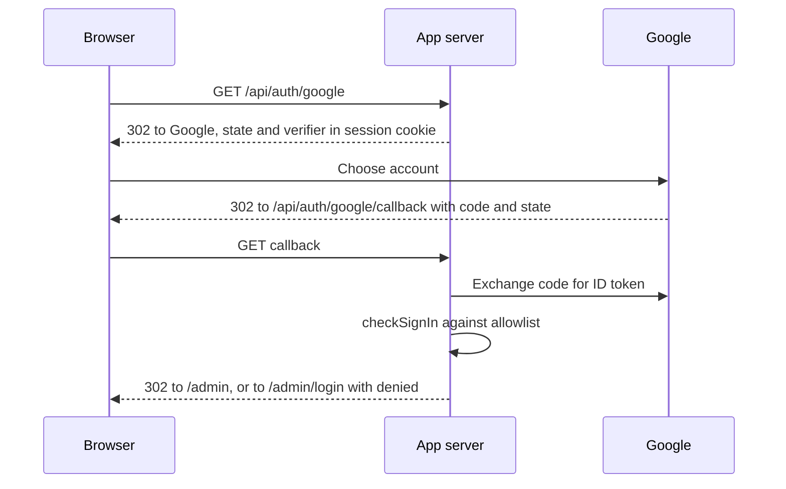

# 03. Sign-in, media storage, click redirect

Part of the [pqacam implementation plan](README.md). The Global Constraints in that file apply to each task.

## Contents

- [Task 5: Session and Google sign-in](#task-5-session-and-google-sign-in)
- [Task 6: R2 uploads](#task-6-r2-uploads)
- [Task 7: Click redirect](#task-7-click-redirect)

---

## Task 5: Session and Google sign-in



**Files:**
- Create: `src/server/signin.ts`, `src/server/auth.ts`
- Create: `src/routes/api/auth/google/index.ts`, `src/routes/api/auth/google/callback.ts`, `src/routes/admin/login.tsx`
- Create: `.env.example`
- Modify: `src/styles.css`
- Test: `tests/signin.test.ts`

**Interfaces:**
- Consumes: `isAdmin(db, email)` (Task 4), `getDb()`, `Db` (Task 2), `env()` (Task 2).
- Produces:
  - `checkSignIn(db: Db, claims: unknown): { ok: true; email: string; name: string } | { ok: false; reason: 'unverified' | 'denied'; email: string }` from `src/server/signin.ts`
  - `appSession()`, `requireAdmin(): Promise<{ email: string; name: string }>`, `google()` from `src/server/auth.ts`
  - Routes `/api/auth/google`, `/api/auth/google/callback`, and `/admin/login`
  - Sign-in failure redirects to `/admin/login?denied=<email>` or `/admin/login?failed=1`

- [ ] **Step 1: Write the failing test**

`tests/signin.test.ts`:

```ts
import { expect, test } from 'bun:test'
import { openDb } from '../src/server/db'
import { checkSignIn } from '../src/server/signin'

const db = openDb(':memory:', 'owner@example.com')

test('an allowlisted, verified email signs in, and letter case is ignored', () => {
  expect(checkSignIn(db, { email: 'Owner@Example.com', email_verified: true, name: 'Owner' })).toEqual({
    ok: true,
    email: 'owner@example.com',
    name: 'Owner',
  })
})

test('the email is used as the name when Google sends no name', () => {
  expect(checkSignIn(db, { email: 'owner@example.com', email_verified: true })).toMatchObject({ name: 'owner@example.com' })
})

test('an email that is not in the allowlist is denied', () => {
  expect(checkSignIn(db, { email: 'guest@example.com', email_verified: true })).toEqual({
    ok: false,
    reason: 'denied',
    email: 'guest@example.com',
  })
})

test('an unverified email is refused, also when it is in the allowlist', () => {
  expect(checkSignIn(db, { email: 'owner@example.com', email_verified: false })).toMatchObject({ ok: false, reason: 'unverified' })
  expect(checkSignIn(db, { email: 'owner@example.com' })).toMatchObject({ ok: false, reason: 'unverified' })
})

test('claims with no email are refused', () => {
  expect(checkSignIn(db, null)).toMatchObject({ ok: false })
  expect(checkSignIn(db, { email_verified: true })).toMatchObject({ ok: false })
})
```

- [ ] **Step 2: Run the test to see it fail**

Run: `bun test tests/signin.test.ts`
Expected: FAIL. `Cannot find module '../src/server/signin'`.

- [ ] **Step 3: Write the sign-in check**

`src/server/signin.ts`:

```ts
import { isAdmin } from './catalog'
import type { Db } from './db'

export type SignIn =
  | { ok: true; email: string; name: string }
  | { ok: false; reason: 'unverified' | 'denied'; email: string }

export function checkSignIn(db: Db, claims: unknown): SignIn {
  const c = (claims ?? {}) as Record<string, unknown>
  const email = typeof c.email === 'string' ? c.email.trim().toLowerCase() : ''
  if (!email || c.email_verified !== true) return { ok: false, reason: 'unverified', email }
  if (!isAdmin(db, email)) return { ok: false, reason: 'denied', email }
  return { ok: true, email, name: typeof c.name === 'string' && c.name ? c.name : email }
}
```

- [ ] **Step 4: Run the test to see it pass**

Run: `bun test tests/signin.test.ts`
Expected: 5 pass.

- [ ] **Step 5: Write the session module**

`src/server/auth.ts`:

```ts
import { redirect } from '@tanstack/react-router'
import { useSession } from '@tanstack/react-start/server'
import { Google } from 'arctic'
import { isAdmin } from './catalog'
import { getDb } from './db'
import { env } from './env'

type SessionData = { email?: string; name?: string; oauthState?: string; oauthVerifier?: string }

export function appSession() {
  return useSession<SessionData>({
    name: 'pqacam',
    password: env('SESSION_SECRET'),
    maxAge: 60 * 60 * 24 * 30,
    cookie: { httpOnly: true, sameSite: 'lax', secure: env('PUBLIC_URL').startsWith('https://') },
  })
}

// The allowlist is read on each call, so a removed admin loses access on the next request.
export async function requireAdmin(): Promise<{ email: string; name: string }> {
  const { email, name } = (await appSession()).data
  if (!email || !isAdmin(getDb(), email)) throw redirect({ to: '/admin/login' })
  return { email, name: name ?? email }
}

export function google() {
  return new Google(env('GOOGLE_CLIENT_ID'), env('GOOGLE_CLIENT_SECRET'), `${env('PUBLIC_URL')}/api/auth/google/callback`)
}
```

- [ ] **Step 6: Write the two OAuth routes**

`src/routes/api/auth/google/index.ts`:

```ts
import { createFileRoute } from '@tanstack/react-router'
import { generateCodeVerifier, generateState } from 'arctic'
import { appSession, google } from '../../../../server/auth'

export const Route = createFileRoute('/api/auth/google/')({
  server: {
    handlers: {
      GET: async () => {
        const oauthState = generateState()
        const oauthVerifier = generateCodeVerifier()
        await (await appSession()).update({ oauthState, oauthVerifier })
        const url = google().createAuthorizationURL(oauthState, oauthVerifier, ['openid', 'email', 'profile'])
        url.searchParams.set('prompt', 'select_account')
        return new Response(null, { status: 302, headers: { Location: url.toString() } })
      },
    },
  },
})
```

`src/routes/api/auth/google/callback.ts`:

```ts
import { createFileRoute } from '@tanstack/react-router'
import { decodeIdToken } from 'arctic'
import { appSession, google } from '../../../../server/auth'
import { getDb } from '../../../../server/db'
import { checkSignIn } from '../../../../server/signin'

const go = (to: string) => new Response(null, { status: 302, headers: { Location: to } })

export const Route = createFileRoute('/api/auth/google/callback')({
  server: {
    handlers: {
      GET: async ({ request }) => {
        const params = new URL(request.url).searchParams
        const session = await appSession()
        const { oauthState, oauthVerifier } = session.data
        const code = params.get('code')
        if (!code || !oauthState || !oauthVerifier || params.get('state') !== oauthState) {
          await session.clear()
          return go('/admin/login?failed=1')
        }
        let claims: unknown
        try {
          const tokens = await google().validateAuthorizationCode(code, oauthVerifier)
          claims = decodeIdToken(tokens.idToken())
        } catch {
          await session.clear()
          return go('/admin/login?failed=1')
        }
        const result = checkSignIn(getDb(), claims)
        if (!result.ok) {
          await session.clear()
          return go(result.reason === 'denied' ? `/admin/login?denied=${encodeURIComponent(result.email)}` : '/admin/login?failed=1')
        }
        await session.update({ email: result.email, name: result.name, oauthState: undefined, oauthVerifier: undefined })
        return go('/admin')
      },
    },
  },
})
```

The ID token comes directly from Google over TLS in exchange for the code, so `decodeIdToken` without a signature check is sufficient here.

- [ ] **Step 7: Write the sign-in page**

Source: the `signedOut` block of `design/Admin.dc.html`. The design's account chooser is a mock of Google's own screen and is not built.

`src/routes/admin/login.tsx`:

```tsx
import { createFileRoute } from '@tanstack/react-router'

type LoginSearch = { denied?: string; failed?: true }

export const Route = createFileRoute('/admin/login')({
  validateSearch: (search: Record<string, unknown>): LoginSearch => ({
    ...(typeof search.denied === 'string' ? { denied: search.denied } : {}),
    ...(search.failed ? { failed: true as const } : {}),
  }),
  head: () => ({ meta: [{ title: 'Admin sign-in' }, { name: 'robots', content: 'noindex' }] }),
  component: Login,
})

function Login() {
  const { denied, failed } = Route.useSearch()
  const error = denied
    ? `${denied} does not have admin access. Ask the owner to add it under Admin access.`
    : failed
      ? 'Sign-in did not finish. Try again.'
      : null
  return (
    <div className="login-page page-glow">
      <div className="login-card">
        <div className="eyebrow">Admin</div>
        <h1 className="login-title">pqacam</h1>
        <p className="login-lead">Sign in to manage your products, reviews and links.</p>
        <a className="login-google" href="/api/auth/google">
          <span className="login-g">G</span>Continue with Google
        </a>
        {error && <div className="error-box">{error}</div>}
        <p className="login-note">Only approved Google accounts can sign in.</p>
      </div>
    </div>
  )
}
```

Add to `src/styles.css`:

```css
.page-glow {
  background:
    radial-gradient(60% 40% at 0% 0%, oklch(0.93 0.04 30) 0%, transparent 70%),
    radial-gradient(55% 45% at 100% 15%, oklch(0.93 0.04 150) 0%, transparent 70%),
    radial-gradient(70% 50% at 20% 100%, oklch(0.93 0.035 260) 0%, transparent 70%),
    radial-gradient(50% 40% at 100% 90%, oklch(0.94 0.04 80) 0%, transparent 70%),
    var(--bg);
}
.eyebrow { font-size: 12px; font-weight: 600; letter-spacing: 0.08em; text-transform: uppercase; color: var(--accent); }
.error-box { box-sizing: border-box; width: 100%; padding: 12px 14px; border-radius: 12px; background: oklch(0.95 0.03 30); color: oklch(0.42 0.1 30); font-size: 13.5px; line-height: 1.45; text-align: left; }
.login-page { min-height: 100vh; display: flex; align-items: center; justify-content: center; padding: 24px; box-sizing: border-box; }
.login-card { width: 100%; max-width: 400px; box-sizing: border-box; padding: 40px 32px; border-radius: 28px; background: oklch(0.99 0.004 80 / 0.8); backdrop-filter: blur(16px); box-shadow: 0 20px 60px oklch(0.5 0.03 60 / 0.12); display: flex; flex-direction: column; align-items: center; gap: 10px; text-align: center; }
.login-title { margin: 0; font-family: var(--serif); font-weight: 400; font-size: 40px; line-height: 1; }
.login-lead { margin: 4px 0 18px; font-size: 14.5px; line-height: 1.5; color: oklch(0.45 0.02 60); text-wrap: pretty; }
.login-google { width: 100%; height: 52px; box-sizing: border-box; border-radius: 14px; border: 1px solid oklch(0.88 0.01 70); background: oklch(0.995 0.002 80); font-size: 15px; font-weight: 600; color: var(--ink); text-decoration: none; display: flex; align-items: center; justify-content: center; gap: 12px; }
.login-google:hover { background: oklch(0.97 0.006 80); }
.login-g { width: 24px; height: 24px; border-radius: 50%; border: 1px solid oklch(0.88 0.01 70); display: flex; align-items: center; justify-content: center; font-weight: 700; font-size: 13px; color: oklch(0.55 0.15 255); }
.login-note { margin: 14px 0 0; font-size: 12px; color: oklch(0.55 0.02 65); }
```

- [ ] **Step 8: Write the environment example**

`.env.example`:

```
PUBLIC_URL=http://localhost:3000
SESSION_SECRET=change-me-to-a-random-string-of-32-characters-or-more
OWNER_EMAIL=you@gmail.com
GOOGLE_CLIENT_ID=
GOOGLE_CLIENT_SECRET=
R2_ACCOUNT_ID=
R2_ACCESS_KEY_ID=
R2_SECRET_ACCESS_KEY=
R2_BUCKET=pqacam-media
MEDIA_BASE_URL=https://media.pqacam.com
DATABASE_PATH=./data/dev.db
```

Copy it to `.env` and fill in the values. Bun reads `.env` automatically.

- [ ] **Step 9: Check the routes**

Run: `bun run dev`, then `curl -si localhost:3000/api/auth/google | grep -iE '^(HTTP|location|set-cookie)'`
Expected: status `302`, a `location` header that starts with `https://accounts.google.com/`, and a `set-cookie` header that starts with `pqacam=`.

Then: `curl -si 'localhost:3000/api/auth/google/callback?code=x&state=y' | grep -iE '^(HTTP|location)'`
Expected: `302` and `location: /admin/login?failed=1`.

Open `http://localhost:3000/admin/login?denied=guest@example.com` in a browser.
Expected: the card from the design, with the message "guest@example.com does not have admin access. Ask the owner to add it under Admin access."

Run: `bun run typecheck`
Expected: no errors.

- [ ] **Step 10: Commit**

```bash
git add -A
git commit -m "feat: add Google sign-in with allowlist"
```

## Task 6: R2 uploads

**Files:**
- Create: `src/server/r2.ts`
- Test: `tests/r2.test.ts`

**Interfaces:**
- Consumes: `env()` (Task 2), `UploadKind` (Task 3).
- Produces, all from `src/server/r2.ts`:
  - `newKey(kind: UploadKind, ext: string): string`, for example `photo/<uuid>.jpg`
  - `presignPut(key: string, contentType: string, size: number): Promise<string>`
  - `deleteObjects(keys: string[]): Promise<void>` (does not throw)

- [ ] **Step 1: Write the failing test**

`tests/r2.test.ts`:

```ts
import { expect, test } from 'bun:test'
import { newKey, presignPut } from '../src/server/r2'
import { validateProduct } from '../src/server/validate'

Object.assign(process.env, {
  R2_ACCOUNT_ID: 'acc',
  R2_ACCESS_KEY_ID: 'id',
  R2_SECRET_ACCESS_KEY: 'secret',
  R2_BUCKET: 'bucket',
})

test('a new key passes product validation', () => {
  const key = newKey('photo', 'jpg')
  const result = validateProduct({ name: 'A', categoryId: 1, shopeeUrl: 'https://a.com', media: [{ type: 'photo', key }] })
  expect(result.ok).toBe(true)
})

test('the presigned URL signs the type and the size and expires in 5 minutes', async () => {
  const url = new URL(await presignPut('photo/x.jpg', 'image/jpeg', 1234))
  expect(url.origin + url.pathname).toBe('https://acc.r2.cloudflarestorage.com/bucket/photo/x.jpg')
  expect(url.searchParams.get('X-Amz-SignedHeaders')).toBe('content-length;content-type;host')
  expect(url.searchParams.get('X-Amz-Expires')).toBe('300')
  expect(url.searchParams.get('X-Amz-Signature')).toMatch(/^[0-9a-f]{64}$/)
})
```

- [ ] **Step 2: Run the test to see it fail**

Run: `bun test tests/r2.test.ts`
Expected: FAIL. `Cannot find module '../src/server/r2'`.

- [ ] **Step 3: Write the module**

`src/server/r2.ts`:

```ts
import { AwsClient } from 'aws4fetch'
import { env } from './env'
import type { UploadKind } from './validate'

const client = () =>
  new AwsClient({
    accessKeyId: env('R2_ACCESS_KEY_ID'),
    secretAccessKey: env('R2_SECRET_ACCESS_KEY'),
    service: 's3',
    region: 'auto',
  })

const objectUrl = (key: string) => `https://${env('R2_ACCOUNT_ID')}.r2.cloudflarestorage.com/${env('R2_BUCKET')}/${key}`

export const newKey = (kind: UploadKind, ext: string) => `${kind}/${crypto.randomUUID()}.${ext}`

// The type and the size are signed, so R2 refuses a PUT with a different file.
export async function presignPut(key: string, contentType: string, size: number): Promise<string> {
  const url = new URL(objectUrl(key))
  url.searchParams.set('X-Amz-Expires', '300')
  const signed = await client().sign(url.toString(), {
    method: 'PUT',
    headers: { 'content-type': contentType, 'content-length': String(size) },
    aws: { signQuery: true, allHeaders: true },
  })
  return signed.url
}

export async function deleteObjects(keys: string[]): Promise<void> {
  await Promise.all(
    keys.map(async (key) => {
      try {
        const response = await client().fetch(objectUrl(key), { method: 'DELETE' })
        if (!response.ok) console.error(`R2 delete failed for ${key}: ${response.status}`)
      } catch (error) {
        console.error(`R2 delete failed for ${key}`, error)
      }
    }),
  )
}
```

A failed delete leaves an unused object in the bucket. It does not break the page, so the function logs the failure and continues.

- [ ] **Step 4: Run the test to see it pass**

Run: `bun test tests/r2.test.ts`
Expected: 2 pass.

- [ ] **Step 5: Commit**

```bash
git add -A
git commit -m "feat: add R2 presigned uploads"
```

## Task 7: Click redirect

**Files:**
- Create: `src/server/click.ts`, `src/routes/go.$productId.$platform.ts`
- Test: `tests/click.test.ts`

**Interfaces:**
- Consumes: `recordClick(db, productId, platform)` (Task 4), `isPlatform` (Task 3), `getDb()` (Task 2).
- Produces: `resolveClick(db: Db, productId: string, platform: string): string | null` from `src/server/click.ts`. Route `GET /go/$productId/$platform`.

- [ ] **Step 1: Write the failing test**

`tests/click.test.ts`:

```ts
import { expect, test } from 'bun:test'
import { addCategory, getAdminData, saveProduct } from '../src/server/catalog'
import { resolveClick } from '../src/server/click'
import { openDb } from '../src/server/db'

const db = openDb(':memory:')
addCategory(db, 'Kitchen')
const { id } = saveProduct(db, {
  name: 'Tumbler',
  categoryId: getAdminData(db, '').categories[0].id,
  price: '',
  review: '',
  shopeeUrl: 'https://shopee.com.my/x',
  tiktokUrl: '',
  whatsappUrl: '',
  hidden: false,
  media: [],
})

test('a good request returns the stored link', () => {
  expect(resolveClick(db, String(id), 'shopee')).toBe('https://shopee.com.my/x')
})

test.each([
  ['abc', 'shopee'],
  ['1.5', 'shopee'],
  ['', 'shopee'],
  [String(id), 'lazada'],
  [String(id), 'tiktok'],
  ['999', 'shopee'],
])('request %s / %s returns null', (productId, platform) => {
  expect(resolveClick(db, productId, platform)).toBeNull()
})
```

- [ ] **Step 2: Run the test to see it fail**

Run: `bun test tests/click.test.ts`
Expected: FAIL. `Cannot find module '../src/server/click'`.

- [ ] **Step 3: Write the function and the route**

`src/server/click.ts`:

```ts
import { recordClick } from './catalog'
import type { Db } from './db'
import { isPlatform } from './validate'

export function resolveClick(db: Db, productId: string, platform: string): string | null {
  if (!/^\d+$/.test(productId) || !isPlatform(platform)) return null
  return recordClick(db, Number(productId), platform)
}
```

`src/routes/go.$productId.$platform.ts`:

```ts
import { createFileRoute } from '@tanstack/react-router'
import { resolveClick } from '../server/click'
import { getDb } from '../server/db'

export const Route = createFileRoute('/go/$productId/$platform')({
  server: {
    handlers: {
      // The destination is read from the product row. Nothing in the request can set it.
      GET: ({ params }) => {
        const url = resolveClick(getDb(), params.productId, params.platform)
        if (!url) return new Response('Not found', { status: 404 })
        return new Response(null, { status: 302, headers: { Location: url, 'Cache-Control': 'no-store' } })
      },
    },
  },
})
```

- [ ] **Step 4: Run the test to see it pass**

Run: `bun test tests/click.test.ts`
Expected: 7 pass.

- [ ] **Step 5: Check the route**

Run: `bun run dev`, then `curl -si localhost:3000/go/abc/shopee | head -1`
Expected: `HTTP/1.1 404 Not Found`.

- [ ] **Step 6: Commit**

```bash
git add -A
git commit -m "feat: add buy-click counter and redirect"
```
