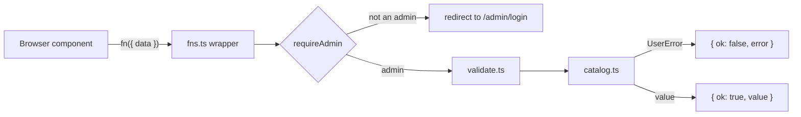

# 04. Server functions

Part of the [pqacam implementation plan](README.md). The Global Constraints in that file apply to each task.

## Task 8: Server functions



**Files:**
- Create: `src/server/fns.ts`

**Interfaces:**
- Consumes: everything from Tasks 2 to 6.
- Produces, all from `src/server/fns.ts`. Each is called as `fn({ data })`. Each admin function returns `Result<T>` and redirects to `/admin/login` when the caller is not an admin.

| Function | `data` | Returns |
|---|---|---|
| `getPublicPageFn` | none | `PublicPage` |
| `getAdminDataFn` | none | `AdminData & { me: { email: string; name: string } }` |
| `saveProductFn` | `ProductInput` | `Result<number>` (product ID) |
| `deleteProductFn` | `number` | `Result<void>` |
| `setHiddenFn` | `{ id: number; hidden: boolean }` | `Result<void>` |
| `moveFn` | `{ kind: 'product' \| 'category'; id: number; dir: -1 \| 1 }` | `Result<void>` |
| `addCategoryFn` | `string` | `Result<void>` |
| `renameCategoryFn` | `{ id: number; name: string }` | `Result<void>` |
| `deleteCategoryFn` | `number` | `Result<void>` |
| `saveProfileFn` | `ProfileInput` | `Result<void>` |
| `addAdminFn` | `string` | `Result<void>` |
| `removeAdminFn` | `string` | `Result<void>` |
| `createUploadFn` | `{ kind: UploadKind; contentType: string; size: number }` | `Result<{ key: string; uploadUrl: string; publicUrl: string }>` |
| `signOutFn` | none | `void` |

- [ ] **Step 1: Write the module**

The `inputValidator` gives the browser the argument type. It does not check the value. Each handler checks the value again, because a request can come from outside the app.

`src/server/fns.ts`:

```ts
import { createServerFn } from '@tanstack/react-start'
import { appSession, requireAdmin } from './auth'
import * as catalog from './catalog'
import { getDb } from './db'
import { env } from './env'
import { deleteObjects, newKey, presignPut } from './r2'
import {
  AVATAR_KEY,
  type ProductInput,
  type Result,
  type UploadKind,
  validateEmail,
  validateProduct,
  validateUpload,
} from './validate'

type Me = { email: string; name: string }
const mediaBase = () => env('MEDIA_BASE_URL')

async function asAdmin<T>(work: (me: Me) => T | Promise<T>): Promise<Result<T>> {
  const me = await requireAdmin()
  try {
    return { ok: true, value: await work(me) }
  } catch (error) {
    if (error instanceof catalog.UserError) return { ok: false, error: error.message }
    throw error
  }
}

function need<T>(result: Result<T>): T {
  if (!result.ok) throw new catalog.UserError(result.error)
  return result.value
}

function int(value: unknown): number {
  if (!Number.isInteger(value)) throw new catalog.UserError('Something went wrong. Reload the page.')
  return value as number
}

const dir = (value: unknown): -1 | 1 => (value === -1 ? -1 : 1)

export const getPublicPageFn = createServerFn({ method: 'GET' }).handler(() => catalog.getPublicPage(getDb(), mediaBase()))

export const getAdminDataFn = createServerFn({ method: 'GET' }).handler(async () => {
  const me = await requireAdmin()
  return { me, ...catalog.getAdminData(getDb(), mediaBase()) }
})

export const saveProductFn = createServerFn({ method: 'POST' })
  .inputValidator((data: ProductInput) => data)
  .handler(({ data }) =>
    asAdmin(async () => {
      const saved = catalog.saveProduct(getDb(), need(validateProduct(data)))
      await deleteObjects(saved.removedKeys)
      return saved.id
    }),
  )

export const deleteProductFn = createServerFn({ method: 'POST' })
  .inputValidator((data: number) => data)
  .handler(({ data }) => asAdmin(() => deleteObjects(catalog.deleteProduct(getDb(), int(data)))))

export const setHiddenFn = createServerFn({ method: 'POST' })
  .inputValidator((data: { id: number; hidden: boolean }) => data)
  .handler(({ data }) => asAdmin(() => catalog.setHidden(getDb(), int(data?.id), data.hidden === true)))

export const moveFn = createServerFn({ method: 'POST' })
  .inputValidator((data: { kind: 'product' | 'category'; id: number; dir: -1 | 1 }) => data)
  .handler(({ data }) =>
    asAdmin(() =>
      data?.kind === 'category'
        ? catalog.moveCategory(getDb(), int(data.id), dir(data.dir))
        : catalog.moveProduct(getDb(), int(data?.id), dir(data?.dir)),
    ),
  )

export const addCategoryFn = createServerFn({ method: 'POST' })
  .inputValidator((data: string) => data)
  .handler(({ data }) => asAdmin(() => catalog.addCategory(getDb(), String(data ?? ''))))

export const renameCategoryFn = createServerFn({ method: 'POST' })
  .inputValidator((data: { id: number; name: string }) => data)
  .handler(({ data }) => asAdmin(() => catalog.renameCategory(getDb(), int(data?.id), String(data.name ?? ''))))

export const deleteCategoryFn = createServerFn({ method: 'POST' })
  .inputValidator((data: number) => data)
  .handler(({ data }) => asAdmin(() => catalog.deleteCategory(getDb(), int(data))))

export const saveProfileFn = createServerFn({ method: 'POST' })
  .inputValidator((data: catalog.ProfileInput) => data)
  .handler(({ data }) =>
    asAdmin(async () => {
      if (data?.avatarKey !== undefined && !AVATAR_KEY.test(String(data.avatarKey))) {
        throw new catalog.UserError('Upload the photo again.')
      }
      const replaced = catalog.saveProfile(getDb(), {
        name: String(data?.name ?? ''),
        handle: String(data?.handle ?? ''),
        bio: String(data?.bio ?? ''),
        whatsapp: String(data?.whatsapp ?? ''),
        avatarKey: data?.avatarKey,
      })
      if (replaced) await deleteObjects([replaced])
    }),
  )

export const addAdminFn = createServerFn({ method: 'POST' })
  .inputValidator((data: string) => data)
  .handler(({ data }) => asAdmin(() => catalog.addAdmin(getDb(), need(validateEmail(data)))))

export const removeAdminFn = createServerFn({ method: 'POST' })
  .inputValidator((data: string) => data)
  .handler(({ data }) => asAdmin((me) => catalog.removeAdmin(getDb(), need(validateEmail(data)), me.email)))

export const createUploadFn = createServerFn({ method: 'POST' })
  .inputValidator((data: { kind: UploadKind; contentType: string; size: number }) => data)
  .handler(({ data }) =>
    asAdmin(async () => {
      const upload = need(validateUpload(data))
      const key = newKey(upload.kind, upload.ext)
      return { key, uploadUrl: await presignPut(key, upload.contentType, upload.size), publicUrl: `${mediaBase()}/${key}` }
    }),
  )

export const signOutFn = createServerFn({ method: 'POST' }).handler(async () => {
  await (await appSession()).clear()
})
```

- [ ] **Step 2: Check types and the build**

Run: `bun run build && bun run typecheck`
Expected: the build completes. No type errors.

The build is part of this check for one reason: `fns.ts` imports `bun:sqlite` through `db.ts`, and the browser bundle must not contain it. The build fails if the compiler cannot remove a server import.

- [ ] **Step 3: Run all tests**

Run: `bun test`
Expected: all pass.

- [ ] **Step 4: Commit**

```bash
git add -A
git commit -m "feat: add server functions"
```
