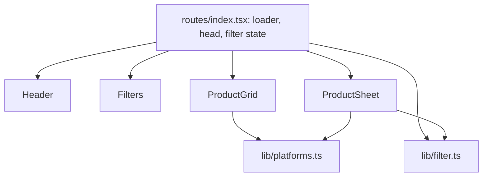

# 05. Public page

Part of the [pqacam implementation plan](README.md). The Global Constraints in that file apply to each task.

## Task 9: Public page



**Files:**
- Create: `src/lib/filter.ts`, `src/lib/platforms.ts`
- Create: `src/components/public/Header.tsx`, `Filters.tsx`, `ProductGrid.tsx`, `ProductSheet.tsx`
- Modify: `src/routes/index.tsx`, `src/styles.css`
- Test: `tests/filter.test.ts`

**Interfaces:**
- Consumes: `getPublicPageFn` (Task 8), types `PublicPage`, `PublicProduct` (Task 4), `PLATFORMS`, `Platform` (Task 3).
- Produces:
  - `filterProducts(products: PublicProduct[], filter: Filter): PublicProduct[]`, `wrap(i: number, n: number): number`, type `Filter = { q: string; category: string; platform: Platform | 'all' }` from `src/lib/filter.ts`
  - `PLATFORM_LABEL: Record<Platform, { chip: string; buy: string }>` from `src/lib/platforms.ts` (Task 10 uses it too)
  - CSS classes `chip`, `chip-shopee`, `chip-tiktok`, `chip-whatsapp`, `pill`, `pill-on` (Task 10 uses them too)

Source for markup and values: `design/Home Finds Links.dc.html`.

- [ ] **Step 1: Write the failing test**

`tests/filter.test.ts`:

```ts
import { expect, test } from 'bun:test'
import { filterProducts, wrap } from '../src/lib/filter'
import type { PublicProduct } from '../src/server/catalog'

const product = (over: Partial<PublicProduct>): PublicProduct => ({
  id: 1,
  name: 'Glass Tumbler',
  category: 'Kitchen',
  price: '',
  review: 'Great for iced coffee',
  platforms: ['shopee'],
  media: [],
  ...over,
})
const list = [product({}), product({ id: 2, name: 'Bud Vase', category: 'Decor', review: 'Handmade', platforms: ['whatsapp'] })]
const ids = (f: Partial<Parameters<typeof filterProducts>[1]>) =>
  filterProducts(list, { q: '', category: 'All', platform: 'all', ...f }).map((p) => p.id)

test('no filter returns all products', () => expect(ids({})).toEqual([1, 2]))
test('category filter', () => expect(ids({ category: 'Decor' })).toEqual([2]))
test('platform filter', () => expect(ids({ platform: 'shopee' })).toEqual([1]))
test('search reads name, category, and review, and ignores case and outer spaces', () => {
  expect(ids({ q: ' TUMBLER ' })).toEqual([1])
  expect(ids({ q: 'decor' })).toEqual([2])
  expect(ids({ q: 'iced coffee' })).toEqual([1])
  expect(ids({ q: 'nothing' })).toEqual([])
})
test('filters combine', () => expect(ids({ category: 'Kitchen', platform: 'whatsapp' })).toEqual([]))
test('wrap keeps a carousel index in range', () => {
  expect(wrap(3, 3)).toBe(0)
  expect(wrap(-1, 3)).toBe(2)
  expect(wrap(1, 3)).toBe(1)
})
```

- [ ] **Step 2: Run the test to see it fail**

Run: `bun test tests/filter.test.ts`
Expected: FAIL. `Cannot find module '../src/lib/filter'`.

- [ ] **Step 3: Write the two lib modules**

`src/lib/filter.ts`:

```ts
import type { PublicProduct } from '../server/catalog'
import type { Platform } from '../server/validate'

export type Filter = { q: string; category: string; platform: Platform | 'all' }

export function filterProducts(products: PublicProduct[], filter: Filter): PublicProduct[] {
  const q = filter.q.trim().toLowerCase()
  const { platform } = filter
  return products.filter(
    (p) =>
      (filter.category === 'All' || p.category === filter.category) &&
      (platform === 'all' || p.platforms.includes(platform)) &&
      (!q || `${p.name} ${p.category} ${p.review}`.toLowerCase().includes(q)),
  )
}

export const wrap = (i: number, n: number) => ((i % n) + n) % n
```

`src/lib/platforms.ts`:

```ts
import type { Platform } from '../server/validate'

export const PLATFORM_LABEL: Record<Platform, { chip: string; buy: string }> = {
  shopee: { chip: 'Shopee', buy: 'Buy on Shopee' },
  tiktok: { chip: 'TikTok', buy: 'Buy on TikTok Shop' },
  whatsapp: { chip: 'WhatsApp', buy: 'Order via WhatsApp' },
}
```

- [ ] **Step 4: Run the test to see it pass**

Run: `bun test tests/filter.test.ts`
Expected: 6 pass.

- [ ] **Step 5: Write the header and the filters**

`src/components/public/Header.tsx`:

```tsx
import type { PublicPage } from '../../server/catalog'

export function Header({ profile }: { profile: PublicPage['profile'] }) {
  return (
    <header className="pp-header">
      <div className="pp-avatar">{profile.avatarUrl && }</div>
      <h1 className="pp-name">{profile.name}</h1>
      <div className="pp-handle">{profile.handle}</div>
      <p className="pp-bio">{profile.bio}</p>
    </header>
  )
}
```

`src/components/public/Filters.tsx`:

```tsx
import type { Filter } from '../../lib/filter'
import { PLATFORM_LABEL } from '../../lib/platforms'
import { PLATFORMS } from '../../server/validate'

type Props = { filter: Filter; categories: string[]; onChange: (patch: Partial<Filter>) => void }

export function Filters({ filter, categories, onChange }: Props) {
  return (
    <div className="pp-filters">
      <div className="pp-search">
        <svg width="18" height="18" viewBox="0 0 24 24" fill="none" stroke="currentColor" strokeWidth="2" strokeLinecap="round" aria-hidden="true">
          <circle cx="11" cy="11" r="7" />
          <line x1="16.5" y1="16.5" x2="21" y2="21" />
        </svg>
        <input
          value={filter.q}
          onChange={(e) => onChange({ q: e.target.value })}
          placeholder="Search my finds…"
          aria-label="Search my finds"
        />
        {filter.q && (
          <button type="button" className="pp-clear" onClick={() => onChange({ q: '' })} aria-label="Clear search">
            ✕
          </button>
        )}
      </div>
      <div className="pp-tabs">
        {['All', ...categories].map((c) => (
          <button
            type="button"
            key={c}
            className={c === filter.category ? 'pill pill-on' : 'pill'}
            onClick={() => onChange({ category: c })}
          >
            {c}
          </button>
        ))}
      </div>
      <div className="pp-platforms">
        <span>Shop on</span>
        {(['all', ...PLATFORMS] as const).map((k) => (
          <button
            type="button"
            key={k}
            className={k === filter.platform ? 'pp-platform pp-platform-on' : 'pp-platform'}
            onClick={() => onChange({ platform: k })}
          >
            <span className={`dot dot-${k}`} />
            {k === 'all' ? 'Any' : PLATFORM_LABEL[k].chip}
          </button>
        ))}
      </div>
    </div>
  )
}
```

- [ ] **Step 6: Write the grid**

`src/components/public/ProductGrid.tsx`:

```tsx
import { PLATFORM_LABEL } from '../../lib/platforms'
import type { PublicProduct } from '../../server/catalog'

export function ProductGrid({ products, onOpen }: { products: PublicProduct[]; onOpen: (id: number) => void }) {
  return (
    <div className="pp-grid">
      {products.map((p) => {
        const cover = p.media.find((m) => m.type === 'photo')
        const photos = p.media.filter((m) => m.type === 'photo').length
        const hasVideo = p.media.length > photos
        return (
          <button type="button" key={p.id} className="pp-card" onClick={() => onOpen(p.id)}>
            <div className="pp-cover" data-protect="">
              {cover && }
              {p.media.length > 0 && (
                <span className="pp-count">
                  {photos}
                  {hasVideo ? ' · ▶' : ''}
                </span>
              )}
            </div>
            <div className="pp-card-body">
              <div className="pp-card-name">{p.name}</div>
              {p.price && <div className="pp-card-price">{p.price}</div>}
              <div className="pp-chips">
                {p.platforms.map((k) => (
                  <span key={k} className={`chip chip-${k}`}>
                    {PLATFORM_LABEL[k].chip}
                  </span>
                ))}
              </div>
            </div>
          </button>
        )
      })}
    </div>
  )
}
```

- [ ] **Step 7: Write the sheet**

`src/components/public/ProductSheet.tsx`:

```tsx
import { useEffect, useRef, useState } from 'react'
import { wrap } from '../../lib/filter'
import { PLATFORM_LABEL } from '../../lib/platforms'
import type { PublicProduct } from '../../server/catalog'

// Deters casual saves. It does not stop a screenshot, and the media URLs are public.
function useMediaProtection() {
  const [hidden, setHidden] = useState(false)
  useEffect(() => {
    const block = (e: Event) => {
      if (e.target instanceof Element && e.target.closest('[data-protect]')) e.preventDefault()
    }
    const hide = () => setHidden(true)
    const show = () => setHidden(false)
    const visibility = () => setHidden(document.hidden)
    document.addEventListener('contextmenu', block)
    document.addEventListener('dragstart', block)
    document.addEventListener('visibilitychange', visibility)
    window.addEventListener('blur', hide)
    window.addEventListener('focus', show)
    return () => {
      document.removeEventListener('contextmenu', block)
      document.removeEventListener('dragstart', block)
      document.removeEventListener('visibilitychange', visibility)
      window.removeEventListener('blur', hide)
      window.removeEventListener('focus', show)
    }
  }, [])
  return hidden
}

type Props = { product: PublicProduct; handle: string; onClose: () => void }

export function ProductSheet({ product, handle, onClose }: Props) {
  const { media } = product
  const [index, setIndex] = useState(0)
  const [paused, setPaused] = useState(false)
  const swipeStart = useRef<number | null>(null)
  const hidden = useMediaProtection()
  const current = media.length ? wrap(index, media.length) : 0

  useEffect(() => {
    if (paused || media.length < 2) return
    const timer = setTimeout(() => setIndex((i) => i + 1), media[current].type === 'video' ? 7000 : 3500)
    return () => clearTimeout(timer)
  }, [current, paused, media])

  useEffect(() => {
    const onKey = (e: KeyboardEvent) => e.key === 'Escape' && onClose()
    window.addEventListener('keydown', onKey)
    return () => window.removeEventListener('keydown', onKey)
  }, [onClose])

  const go = (i: number) => {
    setIndex(i)
    setPaused(true)
  }

  return (
    <div className="pp-backdrop" onClick={onClose}>
      <div className="pp-sheet" role="dialog" aria-modal="true" aria-label={product.name} onClick={(e) => e.stopPropagation()}>
        <div className="pp-grip" />
        <div
          className="pp-stage"
          data-protect=""
          onPointerDown={(e) => {
            swipeStart.current = e.clientX
          }}
          onPointerUp={(e) => {
            const dx = e.clientX - (swipeStart.current ?? e.clientX)
            swipeStart.current = null
            if (Math.abs(dx) > 40) go(current + (dx < 0 ? 1 : -1))
          }}
        >
          <div className="pp-track" style={{ transform: `translateX(${-current * 100}%)` }}>
            {media.map((m, i) => (
              <div className="pp-slide" key={m.url}>
                {m.type === 'photo' && }
                {m.type === 'video' && i === current && (
                  <video
                    src={m.url}
                    autoPlay
                    muted
                    loop
                    playsInline
                    disablePictureInPicture
                    controlsList="nodownload noplaybackrate noremoteplayback"
                  />
                )}
                {m.type === 'video' && <span className="pp-video-tag">▶ Video</span>}
              </div>
            ))}
          </div>
          <div className="pp-watermark">
            <span>{handle}</span>
          </div>
          {hidden && <div className="pp-protected">Content protected</div>}
          <button type="button" className="pp-round pp-close" onClick={onClose} aria-label="Close">
            ✕
          </button>
          {media.length > 1 && (
            <>
              <div className="pp-counter">
                {current + 1} / {media.length}
              </div>
              <button type="button" className="pp-round pp-prev" onClick={() => go(current - 1)} aria-label="Previous">
                ‹
              </button>
              <button type="button" className="pp-round pp-next" onClick={() => go(current + 1)} aria-label="Next">
                ›
              </button>
              <div className="pp-dots">
                {media.map((m, i) => (
                  <button
                    type="button"
                    key={m.url}
                    className={i === current ? 'pp-dot pp-dot-on' : 'pp-dot'}
                    onClick={() => go(i)}
                    aria-label={`Go to slide ${i + 1}`}
                  />
                ))}
              </div>
            </>
          )}
        </div>
        <div className="pp-title">
          <div className="eyebrow pp-category">{product.category}</div>
          <div className="pp-title-row">
            <h2>{product.name}</h2>
            {product.price && <div className="pp-price">{product.price}</div>}
          </div>
        </div>
        {product.review && (
          <div className="pp-review">
            <div className="pp-review-title">My honest review</div>
            <p>{product.review}</p>
          </div>
        )}
        <div className="pp-buy">
          {product.platforms.map((k) => (
            <a key={k} className={`pp-buy-button buy-${k}`} href={`/go/${product.id}/${k}`} target="_blank" rel="noopener">
              {PLATFORM_LABEL[k].buy} <span>→</span>
            </a>
          ))}
        </div>
      </div>
    </div>
  )
}
```

- [ ] **Step 8: Write the route**

Replace `src/routes/index.tsx`:

```tsx
import { createFileRoute } from '@tanstack/react-router'
import { useCallback, useState } from 'react'
import { Filters } from '../components/public/Filters'
import { Header } from '../components/public/Header'
import { ProductGrid } from '../components/public/ProductGrid'
import { ProductSheet } from '../components/public/ProductSheet'
import { type Filter, filterProducts } from '../lib/filter'
import { getPublicPageFn } from '../server/fns'

const NO_FILTER: Filter = { q: '', category: 'All', platform: 'all' }

export const Route = createFileRoute('/')({
  loader: () => getPublicPageFn(),
  head: ({ loaderData }) => {
    const title = loaderData?.profile.name || 'pqacam'
    const description = loaderData?.profile.bio ?? ''
    const image = loaderData?.profile.avatarUrl
    return {
      meta: [
        { title },
        { name: 'description', content: description },
        { property: 'og:type', content: 'website' },
        { property: 'og:title', content: title },
        { property: 'og:description', content: description },
        ...(image ? [{ property: 'og:image', content: image }] : []),
        { name: 'twitter:card', content: 'summary' },
      ],
    }
  },
  component: Home,
})

function Home() {
  const page = Route.useLoaderData()
  const [filter, setFilter] = useState(NO_FILTER)
  const [openId, setOpenId] = useState<number | null>(null)
  const close = useCallback(() => setOpenId(null), [])
  const products = filterProducts(page.products, filter)
  const open = page.products.find((p) => p.id === openId)

  return (
    <div className="pp page-glow">
      <div className="pp-column">
        <Header profile={page.profile} />
        <Filters filter={filter} categories={page.categories} onChange={(patch) => setFilter((f) => ({ ...f, ...patch }))} />
        <ProductGrid products={products} onOpen={setOpenId} />
        {products.length === 0 && (
          <div className="pp-empty">
            <div className="pp-empty-title">Nothing here yet</div>
            <div>
              Try another word, or{' '}
              <button type="button" className="link" onClick={() => setFilter(NO_FILTER)}>
                see all finds
              </button>
              .
            </div>
          </div>
        )}
        <footer className="pp-footer">Some links are affiliate links. Thank you for supporting my little corner ♡</footer>
      </div>
      {open && <ProductSheet key={open.id} product={open} handle={page.profile.handle} onClose={close} />}
    </div>
  )
}
```

`key={open.id}` gives each product a new sheet, so the carousel starts at the first slide.

- [ ] **Step 9: Add the styles**

Add to `src/styles.css`. Each value is from the matching element in `design/Home Finds Links.dc.html`.

```css
button { font: inherit; color: inherit; }
.link { border: none; background: none; padding: 0; cursor: pointer; text-decoration: underline; color: oklch(0.45 0.05 150); }
.chip { font-size: 10.5px; font-weight: 600; padding: 3px 7px; border-radius: 999px; }
.chip-shopee { background: oklch(0.94 0.04 45); color: oklch(0.45 0.12 40); }
.chip-tiktok { background: oklch(0.92 0.008 70); color: oklch(0.28 0.02 60); }
.chip-whatsapp { background: oklch(0.93 0.04 150); color: oklch(0.4 0.09 150); }
.chip-warn { background: oklch(0.95 0.03 30); color: oklch(0.45 0.1 30); }
.pill { flex: none; height: 36px; padding: 0 16px; border-radius: 999px; border: 1px solid var(--line); background: var(--surface); color: oklch(0.38 0.02 60); font-size: 13.5px; font-weight: 500; cursor: pointer; }
.pill-on { border-color: oklch(0.32 0.02 60); background: oklch(0.32 0.02 60); color: oklch(0.98 0.005 80); }

.pp { min-height: 100vh; display: flex; justify-content: center; background-attachment: fixed; }
.pp-column { width: 100%; max-width: 460px; padding: 36px 18px 60px; box-sizing: border-box; display: flex; flex-direction: column; gap: 22px; }
.pp-header { display: flex; flex-direction: column; align-items: center; gap: 10px; text-align: center; }
.pp-avatar { width: 88px; height: 88px; border-radius: 50%; border: 3px solid var(--surface); overflow: hidden; background: repeating-linear-gradient(135deg, oklch(0.9 0.02 70) 0 6px, oklch(0.93 0.015 70) 6px 12px); }
.pp-avatar img, .pp-cover img, .pp-slide img, .pp-slide video { width: 100%; height: 100%; object-fit: cover; display: block; }
.pp-name { margin: 4px 0 0; font-family: var(--serif); font-weight: 400; font-size: 38px; line-height: 1; letter-spacing: -0.01em; }
.pp-handle { font-size: 13px; color: var(--ink-soft); }
.pp-bio { margin: 2px 0 0; font-size: 14.5px; line-height: 1.5; max-width: 320px; text-wrap: pretty; color: oklch(0.4 0.02 60); }

.pp-filters { position: sticky; top: 0; z-index: 5; margin: 0 -18px; padding: 8px 18px; background: oklch(0.98 0.008 75 / 0.55); backdrop-filter: blur(16px); -webkit-backdrop-filter: blur(16px); display: flex; flex-direction: column; gap: 12px; }
.pp-search { display: flex; align-items: center; gap: 10px; height: 50px; padding: 0 6px 0 18px; border-radius: 999px; background: var(--surface); color: var(--ink-soft); box-shadow: 0 1px 2px oklch(0.5 0.03 60 / 0.06), 0 6px 20px oklch(0.5 0.03 60 / 0.06); }
.pp-search input { flex: 1; min-width: 0; height: 100%; border: none; outline: none; background: transparent; font: inherit; font-size: 15px; color: var(--ink); }
.pp-search input::placeholder { color: oklch(0.6 0.02 70); }
.pp-clear { width: 38px; height: 38px; border-radius: 50%; border: none; background: oklch(0.94 0.012 75); color: oklch(0.4 0.02 60); font-size: 16px; cursor: pointer; }
.pp-tabs { display: flex; gap: 8px; overflow-x: auto; scrollbar-width: none; margin: 0 -18px; padding: 0 18px; }
.pp-platforms { display: flex; gap: 6px; align-items: center; font-size: 12.5px; color: var(--ink-soft); }
.pp-platforms > span { margin-right: 4px; }
.pp-platform { height: 30px; padding: 0 12px; border-radius: 999px; border: none; background: transparent; color: oklch(0.45 0.02 65); font-size: 12.5px; font-weight: 500; cursor: pointer; display: flex; align-items: center; gap: 6px; }
.pp-platform-on { background: oklch(0.9 0.02 70); color: oklch(0.28 0.02 60); }
.dot { width: 7px; height: 7px; border-radius: 50%; }
.dot-all { background: oklch(0.7 0.02 70); }
.dot-shopee { background: oklch(0.62 0.15 40); }
.dot-tiktok { background: oklch(0.28 0.02 60); }
.dot-whatsapp { background: oklch(0.55 0.12 150); }

.pp-grid { display: grid; grid-template-columns: repeat(2, minmax(0, 1fr)); gap: 14px; }
.pp-card { border: none; text-align: left; background: var(--surface); border-radius: 20px; padding: 8px 8px 12px; display: flex; flex-direction: column; gap: 10px; cursor: pointer; box-shadow: 0 1px 2px oklch(0.5 0.03 60 / 0.05), 0 8px 24px oklch(0.5 0.03 60 / 0.06); transition: transform 0.2s; }
.pp-card:hover { transform: translateY(-2px); }
.pp-cover { position: relative; aspect-ratio: 1 / 1; overflow: hidden; border-radius: 14px; background: repeating-linear-gradient(135deg, oklch(0.9 0.03 70) 0 7px, oklch(0.95 0.01 75) 7px 14px); }
.pp-count { position: absolute; top: 8px; right: 8px; font-size: 10.5px; font-weight: 600; background: oklch(0.99 0.004 80 / 0.9); color: oklch(0.38 0.02 60); padding: 3px 8px; border-radius: 999px; }
.pp-card-body { padding: 0 4px; display: flex; flex-direction: column; gap: 6px; }
.pp-card-name { font-size: 14px; font-weight: 500; line-height: 1.3; text-wrap: pretty; }
.pp-card-price { font-family: var(--serif); font-size: 19px; line-height: 1; }
.pp-chips { display: flex; flex-wrap: wrap; gap: 4px; }
.pp-empty { text-align: center; padding: 40px 20px; display: flex; flex-direction: column; gap: 6px; align-items: center; font-size: 14px; color: var(--ink-soft); }
.pp-empty-title { font-family: var(--serif); font-size: 26px; color: var(--ink); }
.pp-footer { text-align: center; font-size: 12px; color: oklch(0.55 0.02 65); padding-top: 10px; }

@keyframes fade-in { from { opacity: 0; } to { opacity: 1; } }
@keyframes sheet-up { from { transform: translateY(40px); opacity: 0; } to { transform: none; opacity: 1; } }
.pp-backdrop { position: fixed; inset: 0; z-index: 20; background: oklch(0.3 0.02 60 / 0.35); display: flex; align-items: flex-end; justify-content: center; animation: fade-in 0.2s ease; }
.pp-sheet { width: 100%; max-width: 460px; max-height: 92vh; overflow-y: auto; box-sizing: border-box; background: oklch(0.985 0.006 80); border-radius: 28px 28px 0 0; padding: 10px 20px 28px; display: flex; flex-direction: column; gap: 16px; animation: sheet-up 0.3s cubic-bezier(0.2, 0.8, 0.2, 1); }
.pp-grip { align-self: center; width: 40px; height: 4px; margin: 4px 0; border-radius: 2px; background: oklch(0.85 0.01 70); }
.pp-stage { position: relative; flex: none; aspect-ratio: 4 / 5; border-radius: 20px; overflow: hidden; touch-action: pan-y; background: repeating-linear-gradient(135deg, oklch(0.9 0.03 70) 0 8px, oklch(0.95 0.01 75) 8px 16px); }
.pp-track { display: flex; height: 100%; transition: transform 0.55s cubic-bezier(0.2, 0.8, 0.2, 1); }
.pp-slide { position: relative; flex: 0 0 100%; height: 100%; }
.pp-slide video { pointer-events: none; }
.pp-video-tag { position: absolute; top: 14px; left: 14px; font-size: 11.5px; font-weight: 600; background: oklch(0.26 0.015 60 / 0.75); color: var(--surface); padding: 5px 10px; border-radius: 999px; }
.pp-watermark { position: absolute; inset: 0; z-index: 2; display: flex; align-items: center; justify-content: center; }
.pp-watermark span { font-family: var(--serif); font-style: italic; font-size: 30px; color: oklch(0.99 0.004 80 / 0.45); text-shadow: 0 1px 6px oklch(0.3 0.02 60 / 0.25); transform: rotate(-18deg); white-space: nowrap; }
.pp-protected { position: absolute; inset: 0; z-index: 4; background: oklch(0.93 0.015 75); display: flex; align-items: center; justify-content: center; font-size: 13px; color: oklch(0.45 0.02 65); }
.pp-counter { position: absolute; top: 12px; left: 50%; transform: translateX(-50%); z-index: 3; font-size: 11.5px; font-weight: 600; background: oklch(0.99 0.004 80 / 0.85); color: oklch(0.35 0.02 60); padding: 4px 10px; border-radius: 999px; }
.pp-round { position: absolute; z-index: 5; width: 40px; height: 40px; border-radius: 50%; border: none; background: oklch(0.99 0.004 80 / 0.85); color: oklch(0.35 0.02 60); font-size: 18px; cursor: pointer; }
.pp-close { top: 10px; right: 10px; font-size: 16px; background: var(--surface); }
.pp-prev { left: 10px; top: 50%; transform: translateY(-50%); }
.pp-next { right: 10px; top: 50%; transform: translateY(-50%); }
.pp-dots { position: absolute; bottom: 14px; left: 0; right: 0; z-index: 3; display: flex; justify-content: center; gap: 6px; }
.pp-dot { height: 7px; width: 7px; padding: 0; border: none; border-radius: 4px; background: oklch(0.99 0.004 80 / 0.55); cursor: pointer; transition: width 0.3s, background 0.3s; }
.pp-dot-on { width: 20px; background: var(--surface); }
.pp-title { display: flex; flex-direction: column; gap: 6px; }
.pp-category { font-weight: 500; letter-spacing: 0.06em; }
.pp-title-row { display: flex; justify-content: space-between; align-items: baseline; gap: 12px; }
.pp-title-row h2 { margin: 0; font-family: var(--serif); font-weight: 400; font-size: 30px; line-height: 1.05; text-wrap: pretty; }
.pp-price { font-family: var(--serif); font-size: 24px; white-space: nowrap; }
.pp-review { background: oklch(0.955 0.014 75); border-radius: 18px; padding: 16px 18px; display: flex; flex-direction: column; gap: 8px; }
.pp-review-title { font-family: var(--serif); font-style: italic; font-size: 18px; color: oklch(0.42 0.04 50); }
.pp-review p { margin: 0; font-size: 15px; line-height: 1.6; text-wrap: pretty; white-space: pre-line; color: oklch(0.33 0.02 60); }
.pp-buy { display: flex; flex-direction: column; gap: 10px; }
.pp-buy-button { height: 54px; border-radius: 16px; color: var(--surface); text-decoration: none; font-weight: 600; font-size: 15.5px; display: flex; align-items: center; justify-content: center; gap: 8px; }
.buy-shopee { background: var(--shopee); }
.buy-tiktok { background: var(--tiktok); }
.buy-whatsapp { background: var(--whatsapp); }

[data-protect], [data-protect] * { -webkit-user-select: none; user-select: none; -webkit-touch-callout: none; -webkit-user-drag: none; }
@media print { body { display: none !important; } }
```

- [ ] **Step 10: Check the page**

Run: `bun run typecheck && bun test`
Expected: no type errors. All tests pass.

Put test data in the dev database:

```bash
bun -e "
import { openDb } from './src/server/db'
import { addCategory, getAdminData, saveProduct, saveProfile } from './src/server/catalog'
const db = openDb('./data/dev.db')
saveProfile(db, { name: 'The Cosy Corner', handle: '@thecosycorner', bio: 'Little things that make home feel softer.', whatsapp: '60123456789' })
addCategory(db, 'Kitchen'); addCategory(db, 'Decor')
const [kitchen, decor] = getAdminData(db, '').categories
const base = { price: '', review: 'I use these every day.', shopeeUrl: '', tiktokUrl: '', whatsappUrl: '', hidden: false, media: [] }
saveProduct(db, { ...base, name: 'Bud Vase', categoryId: decor.id, whatsappUrl: 'https://wa.me/60123456789' })
saveProduct(db, { ...base, name: 'Glass Tumbler Set', categoryId: kitchen.id, price: 'RM 24.90', shopeeUrl: 'https://shopee.com.my', tiktokUrl: 'https://www.tiktok.com/shop' })
"
```

Run: `bun run dev`, then `curl -s localhost:3000/ | grep -oE '<title>[^<]*</title>|og:title|Glass Tumbler Set|Bud Vase' | sort -u`
Expected: 4 lines: `<title>The Cosy Corner</title>`, `Bud Vase`, `Glass Tumbler Set`, `og:title`. This shows that the server renders the products and the share tags.

Open `http://localhost:3000/` at a phone width (390 px) next to `design/Home Finds Links.dc.html` and check each row:

| Action | Expected |
|---|---|
| Load | Header, search field, tabs "All / Kitchen / Decor", "Shop on" row, 2 cards. "Glass Tumbler Set" shows "RM 24.90" and Shopee and TikTok chips |
| Type "vase" | 1 card |
| Type "zzz" | "Nothing here yet". "see all finds" restores 2 cards |
| Tap "WhatsApp" in "Shop on" | 1 card: "Bud Vase" |
| Tap a card | Sheet opens from the bottom with the watermark, the review, and one buy button for each link |
| Tap "Buy on Shopee" | New tab opens `https://shopee.com.my` |
| Press Escape, or tap the backdrop | Sheet closes |
| Right-click the media area | No context menu |
| Switch to a different window with the sheet open | Media area shows "Content protected" |

- [ ] **Step 11: Commit**

```bash
git add -A
git commit -m "feat: add public product page"
```
