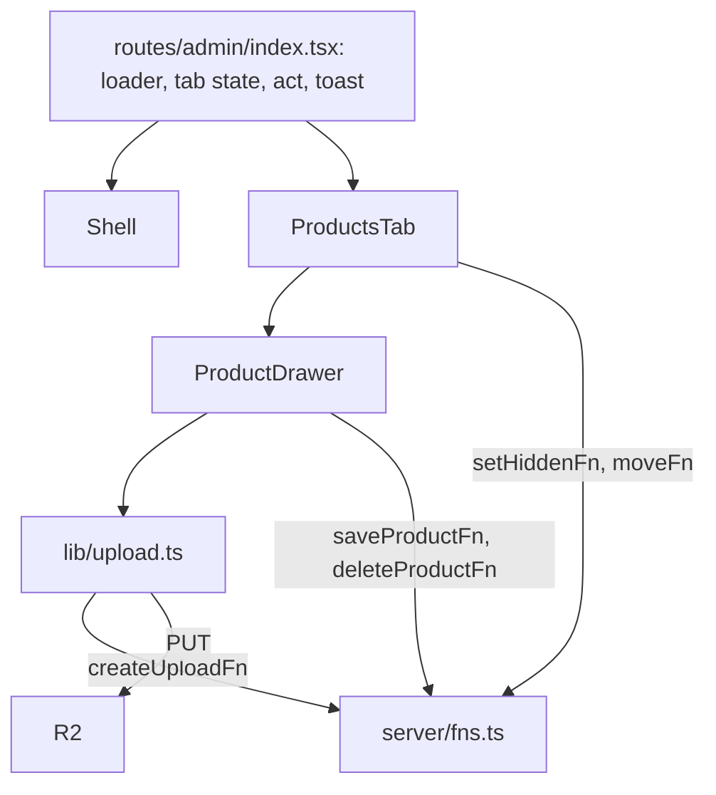

# 06. Admin

Part of the [pqacam implementation plan](README.md). The Global Constraints in that file apply to each task.

Source for markup and values: `design/Admin.dc.html`.

| Change from the design | Reason |
|---|---|
| "Paste a video link" row becomes an "Add video" file button | PRD section 4: videos upload to R2 |
| Category rename saves when the field loses focus, not on each key | A name that is half typed can match another category and be refused |
| Platform chips in a product row include the click count | PRD section 6 |
| Sidebar and top header switch with a CSS media query at 760 px | The design does this with a script. CSS gives the same result with no script |
| "Phone preview" link is not built | It opens a design tool frame, not a product page |

## Task 10: Admin shell and Products tab



**Files:**
- Create: `src/lib/upload.ts`
- Create: `src/components/admin/Shell.tsx`, `ProductsTab.tsx`, `ProductDrawer.tsx`
- Create: `src/routes/admin/index.tsx`
- Modify: `src/styles.css`

**Interfaces:**
- Consumes: all functions from `src/server/fns.ts` (Task 8), `AdminData`, `AdminProduct` (Task 4), `PLATFORM_LABEL` and the `chip` and `pill` classes (Task 9), `Result`, `UploadKind`, `PLATFORMS` (Task 3).
- Produces:
  - `resizeImage(file: Blob, max: number): Promise<Blob>`, `uploadFile(kind: UploadKind, blob: Blob): Promise<Result<{ key: string; url: string }>>` from `src/lib/upload.ts`
  - types `Tab = 'products' | 'categories' | 'profile' | 'admins'`, `Act = (work: Promise<Result<unknown>>, done?: string) => Promise<boolean>`, `TabProps = { data: AdminData; act: Act; flash: (text: string) => void }` from `src/components/admin/Shell.tsx`
  - Route `/admin`. Task 11 adds three tab components to it.
  - CSS classes `ad-head`, `ad-list`, `ad-row`, `ad-field`, `ad-input`, `btn`, `btn-dark`, `btn-light`, `btn-icon`, `btn-danger`, `switch`

- [ ] **Step 1: Write the upload helper**

`src/lib/upload.ts`:

```ts
import { createUploadFn } from '../server/fns'
import type { Result, UploadKind } from '../server/validate'

export async function resizeImage(file: Blob, max: number): Promise<Blob> {
  const bitmap = await createImageBitmap(file, { imageOrientation: 'from-image' })
  const scale = Math.min(1, max / Math.max(bitmap.width, bitmap.height))
  const canvas = document.createElement('canvas')
  canvas.width = Math.round(bitmap.width * scale)
  canvas.height = Math.round(bitmap.height * scale)
  canvas.getContext('2d')!.drawImage(bitmap, 0, 0, canvas.width, canvas.height)
  bitmap.close()
  return new Promise((resolve, reject) =>
    canvas.toBlob((blob) => (blob ? resolve(blob) : reject(new Error('resize failed'))), 'image/jpeg', 0.82),
  )
}

export async function uploadFile(kind: UploadKind, blob: Blob): Promise<Result<{ key: string; url: string }>> {
  const ticket = await createUploadFn({ data: { kind, contentType: blob.type, size: blob.size } })
  if (!ticket.ok) return ticket
  // The browser sets Content-Length from the blob. It must match the size that the server signed.
  const put = await fetch(ticket.value.uploadUrl, { method: 'PUT', headers: { 'content-type': blob.type }, body: blob })
  if (!put.ok) return { ok: false, error: 'Upload failed. Try again.' }
  return { ok: true, value: { key: ticket.value.key, url: ticket.value.publicUrl } }
}
```

- [ ] **Step 2: Write the shell**

`src/components/admin/Shell.tsx`:

```tsx
import type { ReactNode } from 'react'
import type { AdminData } from '../../server/catalog'
import type { Result } from '../../server/validate'

export type Tab = 'products' | 'categories' | 'profile' | 'admins'
export type Act = (work: Promise<Result<unknown>>, done?: string) => Promise<boolean>
export type TabProps = { data: AdminData; act: Act; flash: (text: string) => void }

type Props = {
  data: AdminData
  me: { email: string; name: string }
  tab: Tab
  onTab: (tab: Tab) => void
  onSignOut: () => void
  children: ReactNode
}

export function Shell({ data, me, tab, onTab, onSignOut, children }: Props) {
  const nav: [Tab, string, number | ''][] = [
    ['products', 'Products', data.products.length],
    ['categories', 'Categories', data.categories.length],
    ['profile', 'Profile', ''],
    ['admins', 'Admin access', data.admins.length],
  ]
  const initial = (me.name || me.email)[0].toUpperCase()
  const name = data.profile.name || 'pqacam'
  return (
    <div className="ad">
      <header className="ad-top">
        <div className="ad-top-row">
          <div className="ad-brand">
            <span className="ad-brand-name">{name}</span>
            <span className="eyebrow">Admin</span>
          </div>
          <a className="btn btn-light ad-view" href="/" target="_blank" rel="noopener">
            View page ↗
          </a>
          <button type="button" className="ad-me" onClick={onSignOut} title="Sign out">
            {initial}
          </button>
        </div>
        <nav className="ad-pills">
          {nav.map(([key, label]) => (
            <button type="button" key={key} className={key === tab ? 'ad-nav ad-nav-on' : 'ad-nav'} onClick={() => onTab(key)}>
              {label}
            </button>
          ))}
        </nav>
      </header>
      <aside className="ad-side">
        <div className="ad-brand">
          <span className="ad-brand-name">{name}</span>
          <span className="eyebrow">Admin</span>
        </div>
        <nav className="ad-side-nav">
          {nav.map(([key, label, count]) => (
            <button type="button" key={key} className={key === tab ? 'ad-nav ad-nav-on' : 'ad-nav'} onClick={() => onTab(key)}>
              {label}
              <span>{count}</span>
            </button>
          ))}
        </nav>
        <a className="ad-side-link" href="/" target="_blank" rel="noopener">
          View live page ↗
        </a>
        <div className="ad-account">
          <span className="ad-me">{initial}</span>
          <span className="ad-account-text">
            <span>{me.name}</span>
            <span>{me.email}</span>
          </span>
          <button type="button" className="link" onClick={onSignOut}>
            Sign out
          </button>
        </div>
      </aside>
      <main className="ad-main">{children}</main>
    </div>
  )
}
```

- [ ] **Step 3: Write the Products tab**

`src/components/admin/ProductsTab.tsx`:

```tsx
import { useState } from 'react'
import { PLATFORM_LABEL } from '../../lib/platforms'
import type { AdminProduct } from '../../server/catalog'
import { moveFn, setHiddenFn } from '../../server/fns'
import { PLATFORMS } from '../../server/validate'
import { ProductDrawer } from './ProductDrawer'
import type { TabProps } from './Shell'

const URL_FIELD = { shopee: 'shopeeUrl', tiktok: 'tiktokUrl', whatsapp: 'whatsappUrl' } as const

export function ProductsTab({ data, act, flash }: TabProps) {
  const [q, setQ] = useState('')
  const [editing, setEditing] = useState<AdminProduct | 'new' | null>(null)
  const categoryName = new Map(data.categories.map((c) => [c.id, c.name]))
  const needle = q.trim().toLowerCase()
  const rows = data.products.filter((p) => !needle || `${p.name} ${categoryName.get(p.categoryId)}`.toLowerCase().includes(needle))
  const live = data.products.filter((p) => !p.hidden).length
  const last = data.products.length - 1

  return (
    <>
      <div className="ad-head">
        <div>
          <h2>Products</h2>
          <div className="ad-sub">
            {data.products.length} products · {live} live
          </div>
        </div>
        <div className="ad-head-actions">
          <input className="ad-input ad-search" value={q} onChange={(e) => setQ(e.target.value)} placeholder="Search products…" />
          <button
            type="button"
            className="btn btn-dark btn-round"
            onClick={() => (data.categories.length ? setEditing('new') : flash('Add a category first'))}
          >
            + Add product
          </button>
        </div>
      </div>
      <div className="ad-list ad-list-wide">
        {rows.map((p) => {
          const index = data.products.indexOf(p)
          const cover = p.media.find((m) => m.type === 'photo')
          const photos = p.media.filter((m) => m.type === 'photo').length
          const videos = p.media.length - photos
          const linked = PLATFORMS.filter((k) => p[URL_FIELD[k]])
          return (
            <div className={p.hidden ? 'ad-row ad-row-hidden' : 'ad-row'} key={p.id}>
              <button type="button" className="ad-thumb" onClick={() => setEditing(p)} aria-label={`Edit ${p.name}`}>
                {cover && }
              </button>
              <button type="button" className="ad-row-text" onClick={() => setEditing(p)}>
                <span className="ad-row-name">{p.name}</span>
                <span className="ad-row-meta">
                  <span>{categoryName.get(p.categoryId)}</span>
                  <span>·</span>
                  <span>
                    {photos} photo{photos === 1 ? '' : 's'}
                    {videos ? ` · ${videos} video` : ''}
                  </span>
                  {linked.map((k) => (
                    <span key={k} className={`chip chip-${k}`} title="Taps on this buy button">
                      {PLATFORM_LABEL[k].chip} · {p.clicks[k]}
                    </span>
                  ))}
                  {linked.length === 0 && <span className="chip chip-warn">No buy link</span>}
                </span>
              </button>
              <div className="ad-row-actions">
                <button
                  type="button"
                  className="switch-button"
                  onClick={() =>
                    act(setHiddenFn({ data: { id: p.id, hidden: !p.hidden } }), p.hidden ? 'Now live on your page' : 'Hidden from your page')
                  }
                >
                  <span className={p.hidden ? 'switch' : 'switch switch-on'} />
                  {p.hidden ? 'Hidden' : 'Live'}
                </button>
                <button
                  type="button"
                  className="btn-icon"
                  disabled={index === 0}
                  onClick={() => act(moveFn({ data: { kind: 'product', id: p.id, dir: -1 } }))}
                  title="Move up"
                >
                  ↑
                </button>
                <button
                  type="button"
                  className="btn-icon"
                  disabled={index === last}
                  onClick={() => act(moveFn({ data: { kind: 'product', id: p.id, dir: 1 } }))}
                  title="Move down"
                >
                  ↓
                </button>
                <button type="button" className="btn btn-soft" onClick={() => setEditing(p)}>
                  Edit
                </button>
              </div>
            </div>
          )
        })}
        {rows.length === 0 && (
          <div className="ad-none">{needle ? `No products match "${q}".` : 'No products yet. Add your first one.'}</div>
        )}
      </div>
      {editing && (
        <ProductDrawer
          key={editing === 'new' ? 'new' : editing.id}
          product={editing === 'new' ? null : editing}
          data={data}
          act={act}
          flash={flash}
          onClose={() => setEditing(null)}
        />
      )}
    </>
  )
}
```

- [ ] **Step 4: Write the product drawer**

`src/components/admin/ProductDrawer.tsx`:

```tsx
import { useEffect, useState } from 'react'
import { resizeImage, uploadFile } from '../../lib/upload'
import { PLATFORM_LABEL } from '../../lib/platforms'
import type { AdminProduct } from '../../server/catalog'
import { deleteProductFn, saveProductFn } from '../../server/fns'
import { PLATFORMS } from '../../server/validate'
import type { TabProps } from './Shell'

type Props = TabProps & { product: AdminProduct | null; onClose: () => void }
type Draft = Omit<AdminProduct, 'id' | 'clicks'> & { id?: number }

const URL_FIELD = { shopee: 'shopeeUrl', tiktok: 'tiktokUrl', whatsapp: 'whatsappUrl' } as const
const PLACEHOLDER = { shopee: 'https://shopee.com.my/…', tiktok: 'https://www.tiktok.com/…', whatsapp: 'https://wa.me/…' }

export function ProductDrawer({ product, data, act, flash, onClose }: Props) {
  const [draft, setDraft] = useState<Draft>(
    () =>
      product ?? {
        name: '',
        categoryId: data.categories[0].id,
        price: '',
        review: '',
        shopeeUrl: '',
        tiktokUrl: '',
        whatsappUrl: '',
        hidden: false,
        media: [],
      },
  )
  const [uploads, setUploads] = useState(0)
  const [error, setError] = useState('')
  const [confirmDelete, setConfirmDelete] = useState(false)
  const set = (patch: Partial<Draft>) => {
    setDraft((d) => ({ ...d, ...patch }))
    setError('')
  }

  useEffect(() => {
    const onKey = (e: KeyboardEvent) => e.key === 'Escape' && onClose()
    window.addEventListener('keydown', onKey)
    return () => window.removeEventListener('keydown', onKey)
  }, [onClose])

  async function addFiles(type: 'photo' | 'video', files: FileList | null) {
    for (const file of Array.from(files ?? [])) {
      setUploads((n) => n + 1)
      try {
        const result = await uploadFile(type, type === 'photo' ? await resizeImage(file, 1000) : file)
        if (result.ok) setDraft((d) => ({ ...d, media: [...d.media, { type, ...result.value }] }))
        else setError(result.error)
      } catch {
        setError('Could not read this file.')
      } finally {
        setUploads((n) => n - 1)
      }
    }
  }

  function moveEarlier(i: number) {
    const media = draft.media.slice()
    ;[media[i - 1], media[i]] = [media[i], media[i - 1]]
    set({ media })
  }

  function useMyNumber() {
    const number = data.profile.whatsapp
    if (!number) return flash('Add your WhatsApp number in Profile first')
    const message = encodeURIComponent(`Hi! I'd like to order the ${draft.name || 'item'}`)
    set({ whatsappUrl: `https://wa.me/${number}?text=${message}` })
  }

  async function save() {
    const input = { ...draft, media: draft.media.map(({ type, key }) => ({ type, key })) }
    const result = await saveProductFn({ data: input })
    if (!result.ok) return setError(result.error)
    await act(Promise.resolve(result), product ? 'Changes saved' : 'Product added')
    onClose()
  }

  async function remove() {
    if (!confirmDelete) return setConfirmDelete(true)
    if (await act(deleteProductFn({ data: draft.id! }), 'Product deleted')) onClose()
  }

  return (
    <div className="ad-backdrop" onClick={onClose}>
      <div className="ad-drawer" role="dialog" aria-modal="true" onClick={(e) => e.stopPropagation()}>
        <div className="ad-drawer-head">
          <h3>{product ? 'Edit product' : 'New product'}</h3>
          <button type="button" className="ad-x" onClick={onClose} aria-label="Close">
            ✕
          </button>
        </div>
        <div className="ad-drawer-body">
          <div className="ad-field">
            <span className="ad-label">
              Photos &amp; videos <em>First photo is the cover</em>
            </span>
            <div className="ad-media">
              {draft.media.map((m, i) => (
                <div className="ad-tile" key={m.key}>
                  {m.type === 'photo' ?  : <video src={m.url} muted preload="metadata" />}
                  {m.type === 'video' && <span className="ad-tile-tag">▶ Video</span>}
                  <button
                    type="button"
                    className="ad-tile-button ad-tile-remove"
                    onClick={() => set({ media: draft.media.filter((_, j) => j !== i) })}
                    title="Remove"
                  >
                    ✕
                  </button>
                  {i > 0 && (
                    <button type="button" className="ad-tile-button ad-tile-left" onClick={() => moveEarlier(i)} title="Move earlier">
                      ←
                    </button>
                  )}
                </div>
              ))}
              <label className="ad-tile ad-tile-add">
                <span>+</span>Add photos
                <input type="file" accept="image/*" multiple hidden onChange={(e) => (addFiles('photo', e.target.files), (e.target.value = ''))} />
              </label>
              <label className="ad-tile ad-tile-add">
                <span>+</span>Add video
                <input
                  type="file"
                  accept="video/mp4,video/webm,video/quicktime"
                  hidden
                  onChange={(e) => (addFiles('video', e.target.files), (e.target.value = ''))}
                />
              </label>
            </div>
            {uploads > 0 && <span className="ad-hint">Uploading {uploads}…</span>}
          </div>

          <label className="ad-field">
            <span className="ad-label">Product name</span>
            <input className="ad-input" value={draft.name} onChange={(e) => set({ name: e.target.value })} placeholder="e.g. Ribbed Glass Tumbler Set" />
          </label>

          <div className="ad-two">
            <label className="ad-field">
              <span className="ad-label">Category</span>
              <select className="ad-input" value={draft.categoryId} onChange={(e) => set({ categoryId: Number(e.target.value) })}>
                {data.categories.map((c) => (
                  <option key={c.id} value={c.id}>
                    {c.name}
                  </option>
                ))}
              </select>
            </label>
            <label className="ad-field">
              <span className="ad-label">
                Price <em>(optional)</em>
              </span>
              <input className="ad-input" value={draft.price} onChange={(e) => set({ price: e.target.value })} placeholder="RM 24.90" />
            </label>
          </div>

          <label className="ad-field">
            <span className="ad-label">
              My honest review <em>{draft.review.length} characters</em>
            </span>
            <textarea
              className="ad-input"
              rows={5}
              value={draft.review}
              onChange={(e) => set({ review: e.target.value })}
              placeholder="What you love, what to watch out for, any tips…"
            />
          </label>

          <div className="ad-field">
            <span className="ad-label">
              Where to buy <em>Leave blank to hide a button</em>
            </span>
            {PLATFORMS.map((k) => (
              <div className="ad-link-row" key={k}>
                <span className={`chip chip-${k} ad-link-chip`}>{PLATFORM_LABEL[k].chip}</span>
                <input
                  className="ad-input"
                  value={draft[URL_FIELD[k]]}
                  onChange={(e) => set({ [URL_FIELD[k]]: e.target.value })}
                  placeholder={PLACEHOLDER[k]}
                  inputMode="url"
                />
                {k === 'whatsapp' && (
                  <button type="button" className="btn btn-light" onClick={useMyNumber}>
                    Use my number
                  </button>
                )}
              </div>
            ))}
          </div>

          <button type="button" className="switch-button" onClick={() => set({ hidden: !draft.hidden })}>
            <span className={draft.hidden ? 'switch' : 'switch switch-on'} />
            Show on my page
          </button>

          {error && <div className="error-box">{error}</div>}
        </div>
        <div className="ad-drawer-foot">
          {product && (
            <button type="button" className={confirmDelete ? 'btn btn-danger btn-danger-on' : 'btn btn-danger'} onClick={remove}>
              {confirmDelete ? 'Tap again to delete' : 'Delete'}
            </button>
          )}
          <span className="ad-grow" />
          <button type="button" className="btn btn-light" onClick={onClose}>
            Cancel
          </button>
          <button type="button" className="btn btn-dark" onClick={save} disabled={uploads > 0}>
            Save
          </button>
        </div>
      </div>
    </div>
  )
}
```

A file that is uploaded and then not saved stays in the bucket. Add this comment above `addFiles`: `// ponytail: a cancelled draft leaves its uploads in R2. Add a sweep of keys with no media row if storage grows.`

- [ ] **Step 5: Write the route**

`src/routes/admin/index.tsx`:

```tsx
import { createFileRoute, useRouter } from '@tanstack/react-router'
import { useCallback, useEffect, useState } from 'react'
import { ProductsTab } from '../../components/admin/ProductsTab'
import { type Act, Shell, type Tab } from '../../components/admin/Shell'
import { getAdminDataFn, signOutFn } from '../../server/fns'

export const Route = createFileRoute('/admin/')({
  loader: () => getAdminDataFn(),
  head: () => ({ meta: [{ title: 'Admin' }, { name: 'robots', content: 'noindex' }] }),
  component: Admin,
})

function Admin() {
  const { me, ...data } = Route.useLoaderData()
  const router = useRouter()
  const [tab, setTab] = useState<Tab>('products')
  const [toast, setToast] = useState('')

  useEffect(() => {
    if (!toast) return
    const timer = setTimeout(() => setToast(''), 2200)
    return () => clearTimeout(timer)
  }, [toast])

  const act: Act = useCallback(
    async (work, done) => {
      try {
        const result = await work
        if (!result.ok) {
          setToast(result.error)
          return false
        }
        await router.invalidate()
        if (done) setToast(done)
        return true
      } catch {
        // A lost session makes the server function throw. The reload sends the admin to the sign-in page.
        await router.invalidate()
        setToast('Something went wrong. Try again.')
        return false
      }
    },
    [router],
  )

  const signOut = async () => {
    await signOutFn()
    await router.navigate({ to: '/admin/login' })
  }

  const props = { data, act, flash: setToast }
  return (
    <Shell data={data} me={me} tab={tab} onTab={setTab} onSignOut={signOut}>
      {tab === 'products' && <ProductsTab {...props} />}
      {toast && <div className="ad-toast">{toast}</div>}
    </Shell>
  )
}
```

- [ ] **Step 6: Add the styles**

Add to `src/styles.css`. Each value is from the matching element in `design/Admin.dc.html`.

```css
.btn { height: 44px; padding: 0 18px; border-radius: 12px; border: none; font-size: 14px; font-weight: 600; cursor: pointer; display: inline-flex; align-items: center; justify-content: center; text-decoration: none; white-space: nowrap; }
.btn:disabled, .btn-icon:disabled { opacity: 0.4; cursor: default; }
.btn-dark { background: oklch(0.3 0.02 60); color: oklch(0.98 0.005 80); }
.btn-light { border: 1px solid oklch(0.88 0.01 70); background: var(--surface); color: oklch(0.32 0.02 60); }
.btn-soft { height: 32px; padding: 0 14px; border-radius: 10px; font-size: 13px; background: oklch(0.94 0.012 75); color: oklch(0.32 0.02 60); }
.btn-round { border-radius: 999px; padding: 0 20px; }
.btn-danger { padding: 0 14px; font-size: 13.5px; background: transparent; color: var(--danger); }
.btn-danger-on { background: oklch(0.55 0.14 30); color: var(--surface); }
.btn-icon { width: 32px; height: 32px; border-radius: 10px; border: 1px solid oklch(0.91 0.01 70); background: var(--surface); color: oklch(0.4 0.02 60); cursor: pointer; }
.switch-button { display: flex; align-items: center; gap: 8px; border: none; background: transparent; padding: 6px; font-size: 12.5px; color: oklch(0.45 0.02 60); cursor: pointer; align-self: flex-start; }
.switch { position: relative; width: 36px; height: 22px; border-radius: 999px; background: oklch(0.86 0.01 70); transition: background 0.2s; }
.switch::after { content: ''; position: absolute; top: 3px; left: 3px; width: 16px; height: 16px; border-radius: 50%; background: var(--surface); box-shadow: 0 1px 3px oklch(0.3 0.02 60 / 0.2); transition: left 0.2s; }
.switch-on { background: oklch(0.55 0.09 150); }
.switch-on::after { left: 17px; }

.ad { min-height: 100vh; display: flex; align-items: flex-start; background: oklch(0.965 0.01 75); }
.ad-brand { display: flex; flex-direction: column; gap: 2px; min-width: 0; flex: 1; }
.ad-brand-name { font-family: var(--serif); font-size: 26px; line-height: 1.05; }
.ad-me { width: 34px; height: 34px; flex: none; border-radius: 50%; border: none; background: oklch(0.62 0.07 150); color: var(--surface); display: flex; align-items: center; justify-content: center; font-weight: 600; }
.ad-nav { border: none; border-radius: 12px; background: transparent; color: oklch(0.42 0.02 60); font-size: 14.5px; font-weight: 500; cursor: pointer; }
.ad-nav-on { background: oklch(0.92 0.02 75); color: oklch(0.25 0.02 60); }
.ad-top { display: none; }
.ad-side { flex: none; width: 240px; box-sizing: border-box; min-height: 100vh; position: sticky; top: 0; padding: 28px 18px; display: flex; flex-direction: column; gap: 24px; border-right: 1px solid oklch(0.91 0.01 70); background: oklch(0.975 0.008 75); }
.ad-side .ad-brand { flex: none; padding: 0 10px; }
.ad-side-nav { display: flex; flex-direction: column; gap: 4px; }
.ad-side-nav .ad-nav { height: 42px; padding: 0 12px; display: flex; align-items: center; justify-content: space-between; text-align: left; }
.ad-side-nav .ad-nav span { font-size: 12px; opacity: 0.7; }
.ad-side-link { padding: 0 10px; font-size: 13.5px; font-weight: 500; text-decoration: none; color: oklch(0.45 0.05 150); }
.ad-account { margin-top: auto; display: flex; align-items: center; gap: 10px; padding: 12px 10px; border-top: 1px solid oklch(0.91 0.01 70); font-size: 12.5px; }
.ad-account-text { display: flex; flex-direction: column; min-width: 0; flex: 1; }
.ad-account-text span:first-child { font-size: 13.5px; font-weight: 500; }
.ad-account-text span:last-child { font-size: 11.5px; color: var(--ink-soft); overflow: hidden; text-overflow: ellipsis; }
.ad-main { flex: 1; min-width: 0; max-width: 1040px; box-sizing: border-box; padding: 24px clamp(16px, 4vw, 48px) 80px; display: flex; flex-direction: column; gap: 22px; }
@media (max-width: 759px) {
  .ad { flex-direction: column; }
  .ad-side { display: none; }
  .ad-top { display: flex; flex-direction: column; gap: 10px; position: sticky; top: 0; z-index: 10; width: 100%; box-sizing: border-box; padding: 14px 16px 10px; background: oklch(0.975 0.008 75 / 0.92); backdrop-filter: blur(14px); -webkit-backdrop-filter: blur(14px); border-bottom: 1px solid oklch(0.91 0.01 70); }
  .ad-top-row { display: flex; align-items: center; gap: 10px; }
  .ad-top .ad-brand-name { font-size: 22px; }
  .ad-top .eyebrow { font-size: 10.5px; }
  .ad-view { height: 36px; padding: 0 12px; border-radius: 999px; font-size: 12.5px; }
  .ad-top .ad-me { width: 36px; height: 36px; cursor: pointer; }
  .ad-pills { display: flex; gap: 6px; overflow-x: auto; scrollbar-width: none; margin: 0 -16px; padding: 0 16px; }
  .ad-pills .ad-nav { flex: none; height: 36px; padding: 0 14px; border-radius: 999px; font-size: 13.5px; }
  .ad-main { width: 100%; }
}

.ad-head { display: flex; flex-wrap: wrap; align-items: flex-end; justify-content: space-between; gap: 16px; }
.ad-head h2 { margin: 0 0 4px; font-family: var(--serif); font-weight: 400; font-size: 38px; line-height: 1; }
.ad-sub { font-size: 13.5px; color: var(--ink-soft); }
.ad-head-actions { display: flex; gap: 10px; flex-wrap: wrap; }
.ad-input { box-sizing: border-box; width: 100%; min-width: 0; height: 44px; padding: 0 14px; border-radius: 12px; border: 1px solid var(--line); background: var(--surface); font: inherit; font-size: 14.5px; color: var(--ink); outline: none; }
.ad-input:focus { border-color: oklch(0.7 0.06 150); }
.ad-input::placeholder { color: oklch(0.62 0.02 70); }
textarea.ad-input { height: auto; padding: 12px 14px; line-height: 1.55; resize: vertical; }
.ad-search { width: 220px; max-width: 100%; border-radius: 999px; font-size: 14px; }
.ad-list { display: flex; flex-direction: column; gap: 10px; max-width: 560px; }
.ad-list-wide { max-width: none; }
.ad-row { display: flex; flex-wrap: wrap; align-items: center; gap: 12px 14px; padding: 10px 14px 10px 10px; border-radius: 18px; background: var(--surface); box-shadow: 0 1px 2px oklch(0.5 0.03 60 / 0.05), 0 6px 18px oklch(0.5 0.03 60 / 0.05); }
.ad-row-hidden { opacity: 0.55; }
.ad-thumb { width: 60px; height: 60px; flex: none; padding: 0; border: none; border-radius: 12px; overflow: hidden; cursor: pointer; background: repeating-linear-gradient(135deg, oklch(0.9 0.03 70) 0 6px, oklch(0.95 0.01 75) 6px 12px); }
.ad-thumb img, .ad-tile img, .ad-tile video, .ad-avatar img { width: 100%; height: 100%; object-fit: cover; display: block; }
.ad-row-text { flex: 1 1 160px; min-width: 0; border: none; background: none; padding: 0; text-align: left; cursor: pointer; display: flex; flex-direction: column; gap: 5px; }
.ad-row-name { font-size: 15px; font-weight: 500; line-height: 1.25; }
.ad-row-meta { display: flex; flex-wrap: wrap; align-items: center; gap: 6px; font-size: 12px; color: var(--ink-soft); }
.ad-row-actions { display: flex; align-items: center; gap: 6px; flex: none; margin-left: auto; }
.ad-none { padding: 40px; text-align: center; font-size: 14px; color: var(--ink-soft); }

@keyframes drawer-in { from { transform: translateX(40px); opacity: 0; } to { transform: none; opacity: 1; } }
.ad-backdrop { position: fixed; inset: 0; z-index: 20; background: oklch(0.3 0.02 60 / 0.3); display: flex; justify-content: flex-end; animation: fade-in 0.2s; }
.ad-drawer { width: 100%; max-width: 580px; height: 100%; background: oklch(0.98 0.007 78); display: flex; flex-direction: column; animation: drawer-in 0.3s cubic-bezier(0.2, 0.8, 0.2, 1); box-shadow: -20px 0 60px oklch(0.3 0.02 60 / 0.12); }
.ad-drawer-head { display: flex; align-items: center; justify-content: space-between; gap: 12px; padding: 20px 24px; border-bottom: 1px solid oklch(0.91 0.01 70); }
.ad-drawer-head h3 { margin: 0; font-family: var(--serif); font-weight: 400; font-size: 28px; }
.ad-x { width: 38px; height: 38px; border-radius: 50%; border: none; background: oklch(0.94 0.012 75); font-size: 15px; cursor: pointer; color: oklch(0.35 0.02 60); }
.ad-drawer-body { flex: 1; overflow-y: auto; padding: 22px 24px; display: flex; flex-direction: column; gap: 20px; }
.ad-drawer-foot { display: flex; align-items: center; gap: 10px; padding: 16px 24px; border-top: 1px solid oklch(0.91 0.01 70); }
.ad-grow { flex: 1; }
.ad-field { display: flex; flex-direction: column; gap: 6px; }
.ad-label { display: flex; justify-content: space-between; align-items: baseline; gap: 8px; font-size: 12.5px; font-weight: 600; color: oklch(0.42 0.02 60); }
.ad-label em, .ad-hint { font-style: normal; font-weight: 400; font-size: 12px; color: oklch(0.55 0.02 65); }
.ad-two { display: grid; grid-template-columns: repeat(auto-fit, minmax(180px, 1fr)); gap: 14px; }
.ad-media { display: grid; grid-template-columns: repeat(auto-fill, minmax(96px, 1fr)); gap: 10px; margin-top: 4px; }
.ad-tile { position: relative; aspect-ratio: 1 / 1; border-radius: 14px; overflow: hidden; background: repeating-linear-gradient(135deg, oklch(0.9 0.03 70) 0 6px, oklch(0.95 0.01 75) 6px 12px); }
.ad-tile-add { box-sizing: border-box; border: 1.5px dashed oklch(0.82 0.02 70); background: none; display: flex; flex-direction: column; align-items: center; justify-content: center; gap: 4px; cursor: pointer; font-size: 12.5px; font-weight: 600; color: oklch(0.42 0.02 60); }
.ad-tile-add:hover { background: var(--surface); }
.ad-tile-add span { font-size: 20px; font-weight: 400; }
.ad-tile-tag { position: absolute; bottom: 6px; left: 6px; font-size: 10px; font-weight: 600; background: oklch(0.26 0.015 60 / 0.75); color: var(--surface); padding: 3px 7px; border-radius: 999px; }
.ad-tile-button { position: absolute; top: 5px; width: 26px; height: 26px; border-radius: 50%; border: none; background: oklch(0.99 0.004 80 / 0.92); font-size: 11px; cursor: pointer; color: oklch(0.35 0.02 60); }
.ad-tile-remove { right: 5px; }
.ad-tile-left { left: 5px; }
.ad-link-row { display: flex; align-items: center; gap: 10px; margin-top: 4px; }
.ad-link-chip { width: 84px; flex: none; box-sizing: border-box; font-size: 12px; padding: 5px 0; text-align: center; }
.ad-link-row .btn { height: 42px; padding: 0 12px; font-size: 12.5px; color: oklch(0.4 0.09 150); }
.ad-toast { position: fixed; bottom: 24px; left: 50%; transform: translateX(-50%); z-index: 40; background: oklch(0.3 0.02 60); color: oklch(0.98 0.005 80); padding: 12px 20px; border-radius: 999px; font-size: 14px; font-weight: 500; box-shadow: 0 10px 30px oklch(0.3 0.02 60 / 0.25); animation: fade-in 0.2s; }
```

- [ ] **Step 7: Check types and the build**

Run: `bun run build && bun run typecheck && bun test`
Expected: the build completes. No type errors. All tests pass.

- [ ] **Step 8: Check in the browser**

This check needs a Google OAuth client and an R2 bucket. `docs/deploy.md` (Task 12) has the setup steps. For local work, add `http://localhost:3000/api/auth/google/callback` to the OAuth client, and add `http://localhost:3000` to the bucket CORS rule. Put the values in `.env`.

Run: `bun run dev`, then open `http://localhost:3000/admin`.

| Action | Expected |
|---|---|
| Open `/admin` when signed out | Redirect to `/admin/login` |
| Sign in with a Google account that is not `OWNER_EMAIL` | Back on the sign-in page with "does not have admin access" |
| Sign in with `OWNER_EMAIL` | Products tab with the count line |
| "+ Add product" with no category | Toast "Add a category first" |
| Add 3 photos from a phone | 3 tiles show. Each object in the R2 bucket is less than 1 MB |
| Add a video larger than 50 MB | Message "Videos can be 50 MB at most." No object in the bucket |
| Save with no name | "Give your product a name." |
| Save with a link that starts with `http://` | "Links must start with https://" |
| Save a valid product | Drawer closes. Toast "Product added". Row is first in the list |
| Toggle "Live" | Row dims. The product is not on `/` |
| Move down, move up | Order changes. The public page shows the same order |
| Edit, remove one photo, Save | The object is gone from the bucket |
| Delete, tap again | Row is gone. Its objects are gone from the bucket |
| Width less than 760 px | Sidebar is replaced by the top header with tab pills |
| Tap a buy button on `/`, then reload `/admin` | The chip count for that platform is 1 higher |

- [ ] **Step 9: Commit**

```bash
git add -A
git commit -m "feat: add admin shell and product management"
```

## Task 11: Categories, Profile, and Admin access tabs

**Files:**
- Create: `src/components/admin/CategoriesTab.tsx`, `ProfileTab.tsx`, `AdminsTab.tsx`
- Modify: `src/routes/admin/index.tsx`, `src/routes/admin/login.tsx`, `src/styles.css`

**Interfaces:**
- Consumes: `TabProps` (Task 10), `resizeImage`, `uploadFile` (Task 10), server functions (Task 8), CSS classes from Task 10.
- Produces: `CategoriesTab`, `ProfileTab`, `AdminsTab`, each with props `TabProps`. `AdminsTab` also takes `me: string`.

- [ ] **Step 1: Write the Categories tab**

`src/components/admin/CategoriesTab.tsx`:

```tsx
import { useState } from 'react'
import { addCategoryFn, deleteCategoryFn, moveFn, renameCategoryFn } from '../../server/fns'
import type { TabProps } from './Shell'

export function CategoriesTab({ data, act }: TabProps) {
  const [name, setName] = useState('')
  const last = data.categories.length - 1

  async function add() {
    if (name.trim() && (await act(addCategoryFn({ data: name }), 'Category added'))) setName('')
  }

  return (
    <>
      <div className="ad-head">
        <div>
          <h2>Categories</h2>
          <div className="ad-sub">These show as tabs on your page, in this order.</div>
        </div>
      </div>
      <div className="ad-list">
        {data.categories.map((c, i) => (
          <div className="ad-row ad-row-slim" key={`${c.id}:${c.name}`}>
            <input
              className="ad-input ad-inline"
              defaultValue={c.name}
              aria-label="Category name"
              onKeyDown={(e) => e.key === 'Enter' && e.currentTarget.blur()}
              onBlur={async (e) => {
                const input = e.currentTarget
                if (input.value.trim() === c.name) return
                if (!(await act(renameCategoryFn({ data: { id: c.id, name: input.value } })))) input.value = c.name
              }}
            />
            <span className="ad-sub">
              {c.count} product{c.count === 1 ? '' : 's'}
            </span>
            <button type="button" className="btn-icon" disabled={i === 0} onClick={() => act(moveFn({ data: { kind: 'category', id: c.id, dir: -1 } }))} title="Move up">
              ↑
            </button>
            <button type="button" className="btn-icon" disabled={i === last} onClick={() => act(moveFn({ data: { kind: 'category', id: c.id, dir: 1 } }))} title="Move down">
              ↓
            </button>
            <button type="button" className="btn btn-danger btn-small" onClick={() => act(deleteCategoryFn({ data: c.id }), 'Category deleted')}>
              Delete
            </button>
          </div>
        ))}
        <div className="ad-add">
          <input
            className="ad-input"
            value={name}
            onChange={(e) => setName(e.target.value)}
            onKeyDown={(e) => e.key === 'Enter' && add()}
            placeholder="New category, e.g. Bedroom"
          />
          <button type="button" className="btn btn-dark" onClick={add}>
            Add
          </button>
        </div>
      </div>
    </>
  )
}
```

The row key includes the name. After a rename the row is made again, so the field shows the saved name.

- [ ] **Step 2: Write the Profile tab**

`src/components/admin/ProfileTab.tsx`:

```tsx
import { useEffect, useRef, useState } from 'react'
import { resizeImage, uploadFile } from '../../lib/upload'
import { saveProfileFn } from '../../server/fns'
import type { TabProps } from './Shell'

export function ProfileTab({ data, act, flash }: TabProps) {
  const { name, handle, bio, whatsapp, avatarUrl } = data.profile
  const [form, setForm] = useState({ name, handle, bio, whatsapp })
  const edited = useRef(false)

  useEffect(() => {
    if (!edited.current) return
    const timer = setTimeout(() => act(saveProfileFn({ data: form })), 600)
    return () => clearTimeout(timer)
  }, [form, act])

  const field = (key: keyof typeof form) => ({
    className: 'ad-input',
    value: form[key],
    onChange: (e: { target: { value: string } }) => {
      edited.current = true
      setForm((f) => ({ ...f, [key]: e.target.value }))
    },
  })

  async function changeAvatar(file?: File) {
    if (!file) return
    try {
      const result = await uploadFile('avatar', await resizeImage(file, 400))
      if (!result.ok) return flash(result.error)
      await act(saveProfileFn({ data: { ...form, avatarKey: result.value.key } }), 'Photo updated')
    } catch {
      flash('Could not read this file.')
    }
  }

  return (
    <>
      <div className="ad-head">
        <div>
          <h2>Profile</h2>
          <div className="ad-sub">Changes save automatically.</div>
        </div>
      </div>
      <div className="ad-list ad-form">
        <div className="ad-avatar-row">
          <div className="ad-avatar">{avatarUrl && }</div>
          <label className="btn btn-light btn-round">
            Upload photo
            <input type="file" accept="image/*" hidden onChange={(e) => changeAvatar(e.target.files?.[0])} />
          </label>
        </div>
        <label className="ad-field">
          <span className="ad-label">Page name</span>
          <input {...field('name')} />
        </label>
        <label className="ad-field">
          <span className="ad-label">Handle</span>
          <input {...field('handle')} />
        </label>
        <label className="ad-field">
          <span className="ad-label">Bio</span>
          <textarea rows={3} {...field('bio')} />
        </label>
        <label className="ad-field">
          <span className="ad-label">WhatsApp number</span>
          <input {...field('whatsapp')} placeholder="60123456789" inputMode="numeric" />
          <span className="ad-hint">Country code + number, no spaces or +. Used for "Order via WhatsApp" links.</span>
        </label>
      </div>
    </>
  )
}
```

- [ ] **Step 3: Write the Admin access tab**

`src/components/admin/AdminsTab.tsx`:

```tsx
import { useState } from 'react'
import { addAdminFn, removeAdminFn } from '../../server/fns'
import type { TabProps } from './Shell'

export function AdminsTab({ data, act, me }: TabProps & { me: string }) {
  const [email, setEmail] = useState('')

  async function add() {
    if (await act(addAdminFn({ data: email }), 'Access granted')) setEmail('')
  }

  return (
    <>
      <div className="ad-head">
        <div>
          <h2>Admin access</h2>
          <div className="ad-sub">Google accounts allowed to sign in and edit this page.</div>
        </div>
      </div>
      <div className="ad-list">
        {data.admins.map((address) => (
          <div className="ad-row ad-row-slim" key={address}>
            <span className="ad-initial">{address[0].toUpperCase()}</span>
            <span className="ad-email">{address}</span>
            {address === me ? (
              <span className="ad-sub">You</span>
            ) : (
              <button type="button" className="btn btn-danger btn-small" onClick={() => act(removeAdminFn({ data: address }), 'Access removed')}>
                Remove
              </button>
            )}
          </div>
        ))}
        <div className="ad-add">
          <input
            className="ad-input"
            type="email"
            value={email}
            onChange={(e) => setEmail(e.target.value)}
            onKeyDown={(e) => e.key === 'Enter' && add()}
            placeholder="name@gmail.com"
          />
          <button type="button" className="btn btn-dark" onClick={add}>
            Give access
          </button>
        </div>
      </div>
    </>
  )
}
```

- [ ] **Step 4: Show the tabs**

In `src/routes/admin/index.tsx`, add the three imports:

```tsx
import { AdminsTab } from '../../components/admin/AdminsTab'
import { CategoriesTab } from '../../components/admin/CategoriesTab'
import { ProfileTab } from '../../components/admin/ProfileTab'
```

and add three lines below the `ProductsTab` line:

```tsx
      {tab === 'categories' && <CategoriesTab {...props} />}
      {tab === 'profile' && <ProfileTab {...props} />}
      {tab === 'admins' && <AdminsTab {...props} me={me.email} />}
```

- [ ] **Step 5: Show the page name on the sign-in page**

In `src/routes/admin/login.tsx`, add a loader and use it for the heading:

```tsx
import { getPublicPageFn } from '../../server/fns'
```

Add `loader: async () => (await getPublicPageFn()).profile.name,` to the route options. In `Login`, add `const name = Route.useLoaderData()` and change the heading to `<h1 className="login-title">{name || 'pqacam'}</h1>`.

- [ ] **Step 6: Add the styles**

Add to `src/styles.css`. Each value is from the matching element in `design/Admin.dc.html`.

```css
.btn-small { height: 32px; padding: 0 12px; font-size: 13px; font-weight: 400; }
.ad-row-slim { flex-wrap: nowrap; gap: 10px; padding: 8px 10px 8px 8px; border-radius: 16px; box-shadow: 0 1px 2px oklch(0.5 0.03 60 / 0.05); }
.ad-row-slim .ad-sub { font-size: 12.5px; white-space: nowrap; }
.ad-inline { flex: 1; height: 40px; padding: 0 10px; border-radius: 10px; border-color: transparent; background: transparent; font-size: 15px; font-weight: 500; }
.ad-inline:focus { border-color: oklch(0.8 0.04 150); background: oklch(0.98 0.006 80); }
.ad-add { display: flex; gap: 8px; margin-top: 6px; }
.ad-form { gap: 18px; }
.ad-avatar-row { display: flex; align-items: center; gap: 16px; }
.ad-avatar { width: 84px; height: 84px; flex: none; border-radius: 50%; overflow: hidden; background: repeating-linear-gradient(135deg, oklch(0.9 0.02 70) 0 6px, oklch(0.93 0.015 70) 6px 12px); }
.ad-avatar-row .btn { height: 40px; padding: 0 16px; font-size: 13.5px; }
.ad-initial { width: 32px; height: 32px; flex: none; margin-left: 4px; border-radius: 50%; background: oklch(0.9 0.03 150); color: oklch(0.38 0.07 150); display: flex; align-items: center; justify-content: center; font-weight: 600; font-size: 13px; }
.ad-email { flex: 1; min-width: 0; font-size: 14.5px; overflow: hidden; text-overflow: ellipsis; }
```

- [ ] **Step 7: Check types and the build**

Run: `bun run build && bun run typecheck && bun test`
Expected: the build completes. No type errors. All tests pass.

- [ ] **Step 8: Check in the browser**

Run: `bun run dev`, sign in at `http://localhost:3000/admin`.

| Action | Expected |
|---|---|
| Categories: add "Bedroom" | Toast "Category added". A "Bedroom" tab shows on `/` |
| Add "bedroom" again | Toast "That category already exists" |
| Rename a category, then press Enter | The new name shows on `/` and in the product drawer |
| Rename a category to an existing name | Toast "That category already exists". The field goes back to the old name |
| Delete a category that has products | Toast "Move its N products to another category first" |
| Profile: change the bio, wait 1 second, reload `/` | The new bio shows |
| Profile: upload a photo | Toast "Photo updated". The avatar shows on `/`. The old avatar object is gone from the bucket |
| Admin access: add an address with no `@` | Toast "Enter a valid Google email" |
| Add a second Google account, then sign in with it | Sign-in works |
| As the first admin, remove the second. Then, as the second, tap any control | The second admin goes to the sign-in page |
| Look at your own row | It shows "You" and no "Remove" button |
| Sign out, then open `/admin/login` | The heading is the page name from Profile |

- [ ] **Step 9: Commit**

```bash
git add -A
git commit -m "feat: add category, profile, and admin access tabs"
```
