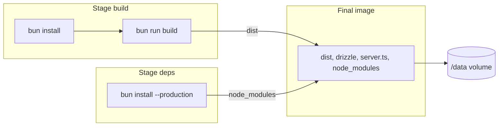
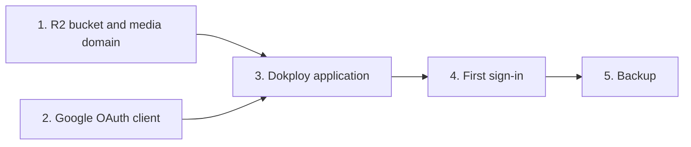

# 07. Deployment

Part of the [pqacam implementation plan](README.md). The Global Constraints in that file apply to each task.

## Task 12: Docker image and Dokploy guide



**Files:**
- Create: `Dockerfile`, `.dockerignore`, `docs/deploy.md`

**Interfaces:**
- Consumes: `bun run build`, `server.ts` (Task 1), `drizzle/` (Task 2), `/api/health` (Task 2), environment variables from `.env.example` (Task 5).
- Produces: an image that listens on port 3000 and stores `pqacam.db` in `/data`.

- [ ] **Step 1: Write the Dockerfile**

`Dockerfile`:

```dockerfile
FROM oven/bun:1 AS build
WORKDIR /app
COPY package.json bun.lock ./
RUN bun install --frozen-lockfile
COPY . .
RUN bun run build

FROM oven/bun:1 AS deps
WORKDIR /app
COPY package.json bun.lock ./
RUN bun install --frozen-lockfile --production

FROM oven/bun:1
WORKDIR /app
ENV NODE_ENV=production PORT=3000 DATABASE_PATH=/data/pqacam.db
# The built server imports its packages at run time, so the image needs node_modules.
COPY --from=deps /app/node_modules ./node_modules
COPY --from=build /app/dist ./dist
COPY drizzle ./drizzle
COPY package.json server.ts ./
VOLUME /data
EXPOSE 3000
HEALTHCHECK --interval=30s --timeout=3s --start-period=10s \
  CMD bun -e "fetch('http://localhost:3000/api/health').then(r => process.exit(r.ok ? 0 : 1)).catch(() => process.exit(1))"
CMD ["bun", "server.ts"]
```

`.dockerignore`:

```
node_modules
dist
data
.env
.git
design
docs
tests
```

- [ ] **Step 2: Build and run the image**

```bash
docker build -t pqacam .
docker run --rm -d --name pqacam-test -p 3002:3000 --env-file .env -e DATABASE_PATH=/data/pqacam.db -v pqacam-test-data:/data pqacam
sleep 3
curl -s localhost:3002/api/health
curl -s localhost:3002/ | grep -o '<title>[^<]*</title>'
```

Expected: `{"ok":true}` and a `<title>` tag.

- [ ] **Step 3: Check that data stays after a restart**

```bash
docker exec pqacam-test ls /data
docker restart pqacam-test && sleep 3
curl -s localhost:3002/api/health
docker inspect --format '{{.State.Health.Status}}' pqacam-test
docker rm -f pqacam-test && docker volume rm pqacam-test-data
```

Expected: `pqacam.db` is in the list. After the restart the health check returns `{"ok":true}`. The health status is `healthy` (it can show `starting` for the first 30 seconds).

- [ ] **Step 4: Write the deployment guide**

`docs/deploy.md`:

````markdown
# Deploy pqacam on Dokploy

## Contents

- [1. Cloudflare R2](#1-cloudflare-r2)
- [2. Google sign-in](#2-google-sign-in)
- [3. Dokploy application](#3-dokploy-application)
- [4. First sign-in](#4-first-sign-in)
- [5. Backup and restore](#5-backup-and-restore)

---



## 1. Cloudflare R2

1. Create a bucket, for example `pqacam-media`.
2. In the bucket settings, connect a custom domain, for example `media.pqacam.com`. This makes the objects public through the Cloudflare CDN.
3. Add this CORS policy to the bucket. It lets the admin page upload files from the browser.

```json
[
  {
    "AllowedOrigins": ["https://pqacam.com"],
    "AllowedMethods": ["PUT"],
    "AllowedHeaders": ["content-type"],
    "MaxAgeSeconds": 3600
  }
]
```

4. Create an R2 API token with "Object Read & Write" permission for this bucket only. Keep the access key ID and the secret access key.

## 2. Google sign-in

1. In Google Cloud Console, create an OAuth client of type "Web application".
2. Add the authorized redirect URI `https://pqacam.com/api/auth/google/callback`.
3. Keep the client ID and the client secret.

## 3. Dokploy application

1. Create an application from the Git repository. Set the build type to "Dockerfile".
2. Add a volume mount: type "Volume", name `pqacam-data`, mount path `/data`.
3. Add the domain `pqacam.com` with port `3000`, HTTPS on, certificate "Let's Encrypt".
4. Set the environment variables.

| Variable | Value |
|---|---|
| `PUBLIC_URL` | `https://pqacam.com` |
| `SESSION_SECRET` | Output of `openssl rand -base64 32` |
| `OWNER_EMAIL` | The Google account of the owner |
| `GOOGLE_CLIENT_ID`, `GOOGLE_CLIENT_SECRET` | From step 2 |
| `R2_ACCOUNT_ID` | The Cloudflare account ID |
| `R2_ACCESS_KEY_ID`, `R2_SECRET_ACCESS_KEY` | From step 1 |
| `R2_BUCKET` | `pqacam-media` |
| `MEDIA_BASE_URL` | `https://media.pqacam.com` |

5. Deploy. `https://pqacam.com/api/health` returns `{"ok":true}`.

## 4. First sign-in

1. Open `https://pqacam.com/admin` and sign in with `OWNER_EMAIL`.
2. In Profile, set the page name, handle, bio, photo, and WhatsApp number.
3. In Categories, add one category or more.
4. In Products, add the first product.

`OWNER_EMAIL` is read only when the admin list is empty. After the first start, change the list in the Admin access tab.

## 5. Backup and restore

| Data | Where | Backup |
|---|---|---|
| Products, categories, profile, admin list, click counts | `/data/pqacam.db` in the `pqacam-data` volume | Dokploy volume backup, each day, to an S3 destination (a second R2 bucket works) |
| Photos and videos | R2 bucket | Not in the volume backup. R2 keeps them when the server is replaced |

To restore: stop the application, restore the volume from the backup in Dokploy, start the application.
````

Replace `pqacam.com` and `media.pqacam.com` in the guide if the real domain is different (PRD section 12).

- [ ] **Step 5: Check the guide**

Run: `grep -c '^```' docs/deploy.md`
Expected: an even number.

- [ ] **Step 6: Commit**

```bash
git add -A
git commit -m "chore: add Dockerfile and Dokploy deployment guide"
```

- [ ] **Step 7: Deploy and run the acceptance check**

Follow `docs/deploy.md` on the Dokploy server. Then check each success criterion from PRD section 2.

| Check | Expected |
|---|---|
| On a phone, sign in and publish a product with 3 photos | Less than 2 minutes |
| On `/`, go from page load to a buy button | 3 taps or fewer: card, buy button |
| Run Lighthouse (mobile) on `/` with 50 products | Largest Contentful Paint less than 2.5 s |
| Paste the page link in a WhatsApp chat | Preview shows the page name, bio, and avatar |
| Tap a buy button, then open `/admin` | The count for that platform went up by 1 |
| Redeploy the application in Dokploy | Products and click counts are the same as before |
