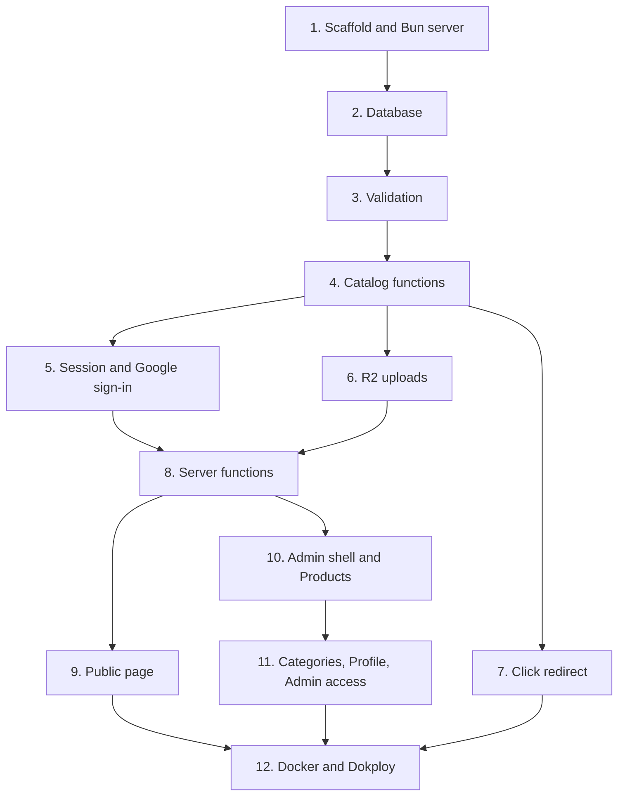

# pqacam Implementation Plan

> **For agentic workers:** REQUIRED SUB-SKILL: Use superpowers:subagent-driven-development (recommended) or superpowers:executing-plans to implement this plan task-by-task. Steps use checkbox (`- [ ]`) syntax for tracking.

**Goal:** Build the pqacam product-finds page and its admin, ready to deploy on Dokploy as one Docker container.

**Architecture:** A TanStack Start app renders the public page on the server and serves the admin. Plain functions in `src/server/` hold all logic and take the database as an argument, so `bun test` covers them without the framework. Server functions and server routes are thin wrappers over those functions.

**Tech Stack:** Bun 1.3+, TanStack Start 1.168 (React 19, Vite 8), Drizzle ORM 0.45 with `bun:sqlite`, Arctic 3 (Google OAuth), aws4fetch (R2 presigned URLs), plain CSS.

**Spec:** [`docs/PRD.md`](../../../PRD.md). Visual reference: [`design/`](../../../../design).

## Contents

- [Task order](#task-order)
- [Global Constraints](#global-constraints)
- [Review Focus](#review-focus)
- [File map](#file-map)
- [Spike findings](#spike-findings)

---

## Task order

| File | Tasks |
|---|---|
| [01-foundation.md](01-foundation.md) | 1, 2 |
| [02-domain.md](02-domain.md) | 3, 4 |
| [03-auth-media-clicks.md](03-auth-media-clicks.md) | 5, 6, 7 |
| [04-server-functions.md](04-server-functions.md) | 8 |
| [05-public-page.md](05-public-page.md) | 9 |
| [06-admin.md](06-admin.md) | 10, 11 |
| [07-deploy.md](07-deploy.md) | 12 |

## Global Constraints

| Constraint | Value |
|---|---|
| Runtime and package manager | Bun only. `bun install`, `bun add`, `bun run`, `bun test`. No npm, no Node |
| Scripts | `dev` is `bun --bun vite dev`. `build` is `bun --bun vite build`. Without `--bun`, Vite runs on Node and `bun:sqlite` does not resolve |
| Production start | `bun server.ts`. No Nitro (see Spike findings) |
| Database driver | `bun:sqlite` through `drizzle-orm/bun-sqlite`. No `better-sqlite3` |
| Imports | Relative paths. No path aliases |
| Styling | One file, `src/styles.css`. Colors, sizes, radii, and fonts are copied from `design/`. No Tailwind, no component library |
| Fonts | Instrument Serif, DM Sans, DM Mono from Google Fonts, as in the design |
| Customization | No theme, color, font, or layout settings in admin |
| Platforms | Exactly `shopee`, `tiktok`, `whatsapp` |
| Photo | JPEG, 1000 px longest side, quality 0.82. Avatar 400 px |
| Video | `video/mp4`, `video/webm`, `video/quicktime`. 50 MB maximum |
| Links | Each buy link starts with `https://` |
| Commits | Conventional commits, short subject, no body. No Claude author, committer, or `Co-Authored-By` line. Example: `feat: add Google sign-in` |
| Text | No em dash character in code, comments, or interface text. The design files have some. Replace each with a comma or a period when porting |

## Review Focus

These inputs are not described in the PRD. Each one has a test in the task named.

| Input or condition | Expected behavior | Test in |
|---|---|---|
| Buy link with `javascript:` or `http://` scheme | Save is rejected with "Links must start with https://" | Task 3 |
| `/go` request for a hidden product, an unknown product, a platform with no link, or an ID that is not a number | 404. No counter changes | Task 4, Task 7 |
| Google returns the email in a different letter case, or with `email_verified: false` | Case is ignored for the allowlist check. An unverified email is refused | Task 5 |
| An admin removes their own email, or the last email | Refused with a message. The row stays | Task 4 |
| Category renamed to an existing name or to an empty name | Refused with a message. No crash, no change | Task 4 |
| Upload request with a size over the limit or a type not in the list | Refused before a presigned URL is made | Task 3 |
| Product with no media | Public payload has `media: []`. The card and the sheet show the placeholder | Task 4, Task 9 |
| "Move up" on the first row, "move down" on the last row | No change, no error | Task 4 |

## File map

| Path | Responsibility |
|---|---|
| `server.ts` | Production entry. Serves `dist/client` files, passes all other requests to the built handler |
| `vite.config.ts`, `tsconfig.json`, `drizzle.config.ts` | Build and tool configuration |
| `drizzle/` | Generated SQL migrations |
| `src/router.tsx`, `src/routes/__root.tsx` | Router and HTML document |
| `src/server/env.ts` | Reads environment variables. Throws when one is missing |
| `src/server/schema.ts` | Drizzle tables |
| `src/server/db.ts` | Opens the database, runs migrations, seeds the profile row and the first admin |
| `src/server/validate.ts` | Input validation. No database, no framework |
| `src/server/catalog.ts` | All reads and writes for products, categories, profile, admins, clicks |
| `src/server/auth.ts` | Session cookie, `requireAdmin`, Google client |
| `src/server/r2.ts` | Presigned PUT URL, object delete, object key |
| `src/server/fns.ts` | `createServerFn` wrappers that the browser calls |
| `src/routes/index.tsx` | Public page route: loader and head tags |
| `src/routes/go.$productId.$platform.ts` | Click count and redirect |
| `src/routes/api/health.ts` | Health check |
| `src/routes/api/auth/google/index.ts`, `callback.ts` | OAuth start and finish |
| `src/routes/admin/login.tsx`, `src/routes/admin/index.tsx` | Admin routes |
| `src/lib/filter.ts` | Product filter and carousel index arithmetic |
| `src/lib/upload.ts` | Photo resize and upload from the browser |
| `src/components/public/` | `Header`, `Filters`, `ProductGrid`, `ProductSheet` |
| `src/components/admin/` | `Shell`, `ProductsTab`, `ProductDrawer`, `CategoriesTab`, `ProfileTab`, `AdminsTab`, `Toast` |
| `src/styles.css` | All styles |
| `tests/` | `bun test` files, one for each `src/server` and `src/lib` module |
| `Dockerfile`, `.dockerignore`, `.env.example`, `docs/deploy.md` | Deployment |

## Spike findings

A throwaway app was built before this plan was written. These results are facts, not assumptions.

| Checked | Result |
|---|---|
| `nitro({ preset: 'bun' })` | Builds. The built server fails at start on Bun 1.3.5 with `SyntaxError: Unexpected keyword 'if'`. Not used |
| `vite build` without Nitro, then `Bun.serve` over `dist/server/server.js` | Works. A server route and a server function both read from `bun:sqlite` |
| `bun --bun vite dev` | Works with `bun:sqlite` |
| Server function validator method | `.inputValidator(...)` |
| `aws4fetch` with `signQuery: true, allHeaders: true` | `X-Amz-SignedHeaders` is `content-length;content-type;host` |
| `dist/server/server.js` | Imports packages from `node_modules` at run time. The production image needs production dependencies |
